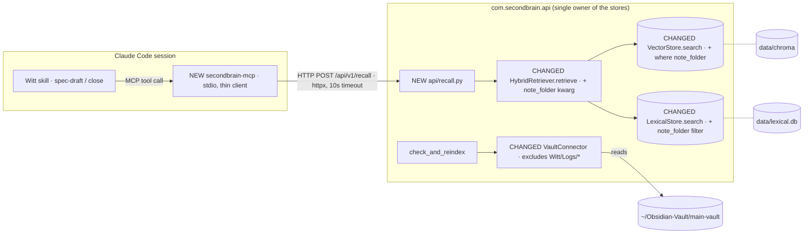

# 001 — SecondBrain recall MCP server for Witt

## Intent
Brent works with Witt, which writes specs, decisions (ADRs) and learnings into
`~/Obsidian-Vault/main-vault/Witt/`. SecondBrain already indexes that vault. Witt's `spec-draft` and
`close` skills need to ask "have I solved this before?" mid-session, but nothing can query
SecondBrain without opening the web UI. This spec adds a local MCP server with a `recall(query,
filters)` tool so an agent can get ranked, cited vault snippets in under a second. It costs
nothing: no LLM calls, no Langfuse. It doesn't touch ChromaDB from a second process, and it doesn't
change any existing API contract.

## Goals
1. Expose a stdio MCP server `secondbrain-mcp` with one tool, `recall(query, filters, limit)`.
2. Serve recall from a new, additive, retrieval-only endpoint, `POST /api/v1/recall`, inside the
   running API process. It does hybrid BM25 + vector search with no rerank, synthesis or conversation writes.
3. Scope recall to Witt notes by default (`Witt/` folder), filterable by Witt project slug and note kind
   (spec / decision / learning / project), with `scope="vault"` to search everything.
4. Stop indexing Witt's daily logs (`Witt/Logs/*`) and keep indexing every other Witt note.
5. Keep recall working while Langfuse is down or tracing is off. Recall adds no spans and imports no tracing code.
6. Keep every existing API contract and the trace JSONL format unchanged. Prove it with the full suite
   plus trace-eval's 9 SecondBrain integration tests.
7. Measure recall quality on a small labelled query set over the running API (recall@5, MRR).

## Non-Goals
- **Witt skill changes** (making `spec-draft` and `close` call `recall`). They live in `~/code/witt/skills/`,
  tracked as a follow-up Witt spec in `~/code/witt` once this one is Approved.
- **LLM rerank or synthesis in recall.** `/ask` already does that. Revisit only if the Evals show
  ranking is the problem (it would be a v2 `rerank: bool` filter).
- **Indexing more frontmatter** (`type`, `project`, `tags` into chunk metadata). Kind and project come
  from Witt's documented path layout, so no schema change or full reindex is needed. Tracked as an open question.
- **Date filters** (`since`). Witt notes carry `created`, not `date`, so `note_date` is empty for most
  of them. Deferred with the frontmatter item above.
- **Fixing the Langfuse launchd job** (Docker daemon not up at login). A separate quick spec in this session.
- **Fixing `make eval`'s in-process Chroma access.** It's an existing second-process risk, out of scope here;
  noted in Risks. The new recall eval avoids it by going over HTTP.

## Design


**Decision 1: thin HTTP client, not direct ChromaDB access.** The MCP server never imports
`chromadb`, `sentence_transformers` or any store. Reasons:
- ChromaDB `PersistentClient` is single-process. That's a known issue here, and the daily sync was
  re-architected around a trigger file because a second process corrupted the stores
  (`docs/devlog/errors/2026-02-06-sqlite-corruption-concurrent-access.md`).
- Claude Code spawns one stdio MCP process **per session**, so direct access would mean N extra
  processes on the same store. That's the worst case of that risk.
- The API already holds the warm embedding model (bge-base, ~400 MB). A direct server would load it
  per session (seconds of startup, more RAM), and the API's reindex lock and epoch coordination
  (`.reindex_lock`, `_check_epoch`) would be bypassed.
- The cost is that recall needs the API up. It's a KeepAlive launchd service, and when it's down the
  tool returns a structured "unavailable" result instead of raising (Interfaces).

**Decision 2: a new endpoint, not `/ask`.** `/ask` reranks and synthesizes with an LLM (seconds and
money per call), writes to the conversation store and the query log. Recall needs none of that. A
new route is additive, so no existing request or response model changes.

**Decision 3: skip `Witt/Logs/*`, index the rest of `Witt/`.** Today all 5 Witt `.md` files are eligible.
`index_tracker` currently holds 3 (`Logs/2026-11-21.md` with 4 chunks, the `witt` hub, ADR-001).
The logs go because:
- Each day's log spans every project and is rewritten all day, so the hourly sync re-chunks and
  re-embeds the whole file. With context generation on, every chunk also gets a fresh Haiku blurb.
  That's cost churn for little signal.
- Log entries are breadcrumbs ("Review of 001 by tester: 0 blocker(s)"). The substance lives in the
  specs, ADRs and learnings they point to. As short, keyword-dense chunks they would crowd out the
  distilled notes in a top-5.

What we lose is reasoning that only exists in log `details`. The mitigation is Witt's `close` skill,
which already promotes real decisions to ADRs and lessons to Learnings. Spec mirrors
(`Projects/*/specs/*.md`) are indexed: they're the only vault copy of specs. Removing the existing
log chunks needs no migration. `classify_changes` reports an excluded, previously tracked file as
deleted, and Step 3 of `check_and_reindex` deletes its chunks from both stores.

**Decision 4: Witt frontmatter needs no ingestion change.** `parse_markdown` (python-frontmatter)
strips YAML before chunking, so frontmatter never reaches chunk text. It uses `title` if it's a
string (spec mirrors have one), falls back to the first H1 (ADRs, learnings, hubs) and then the
filename. It uses `date` for `note_date`. Witt's `type`, `source`, `project`, `created`, `tags` and
`repo` keys are ignored. `note_folder` is the first path segment, so every Witt note gets
`note_folder="Witt"`. That's what makes scope a cheap pre-filter. Malformed YAML raises inside
`read_note`, and `check_and_reindex` logs a warning and skips that file. This spec pins that
behaviour with a test.

**Decision 5: derive scope, project and kind from the path; pre-filter scope in the stores.**
- `scope="witt"` passes `note_folder="Witt"` into both stores (a Chroma `where` and an FTS5
  `AND note_folder = ?`). Witt notes can't be crowded out of the k_vec=30 and k_lex=50 windows by
  the rest of the vault.
- `project` and `kinds` are post-filters over that Witt-only candidate set, using Witt's layout
  (spec 001 Data, `~/code/witt/src/witt/vault.py`): `Projects/<slug>/specs/` is a spec,
  `/decisions/` a decision, `Projects/<slug>/<slug>.md` the project hub, `Learnings/` a learning.
- A `project` filter keeps that project's notes **plus all Learnings**, because learnings are
  cross-project by design and their project lives only in frontmatter.
- Results are deduplicated to the best-scoring chunk per note, so `limit` counts notes, not chunks.

**Decision 6: no tracing in the recall path.** `api/recall.py` and `mcp_server.py` don't import
`secondbrain.tracing` or OpenTelemetry, and the MCP process never calls `init_tracing`. Startup
tracing is unchanged: JSONL always, Langfuse only if reachable at startup (PR #14). So recall's
latency and success never depend on Langfuse, and `data/traces/*.jsonl` gets no new span shapes.

> No ⚠ refactor: the three signature changes are new keyword arguments defaulting to `None`. Every
> existing caller and test keeps today's behaviour.

## Interfaces
```python
# src/secondbrain/models.py  (NEW models; existing models untouched)
RecallKind = Literal["spec", "decision", "learning", "project", "note"]

class RecallFilters(BaseModel):
    """Optional narrowing for recall. Unknown fields are rejected (extra='forbid')."""
    scope: Literal["witt", "vault"] = "witt"   # witt = only notes under Witt/
    project: str | None = None                 # Witt slug; keeps Projects/{slug}/** + Learnings/**
    kinds: list[RecallKind] | None = None      # None = all kinds

class RecallRequest(BaseModel):
    query: str = Field(min_length=1, max_length=2000)   # whitespace-only rejected by validator
    filters: RecallFilters = RecallFilters()
    limit: int = Field(default=5, ge=1, le=20)

class RecallHit(BaseModel):
    note_path: str            # vault-relative, e.g. "Witt/Projects/witt/decisions/ADR-001-….md"
    note_title: str
    heading_path: list[str]
    kind: RecallKind          # "note" only appears with scope="vault"
    project: str | None       # slug from the path; None for Learnings and non-Witt notes
    snippet: str              # best chunk's text, truncated to 600 chars on a word boundary
    score: float              # RRF score of the best chunk; higher is better

class RecallResponse(BaseModel):
    query: str
    hits: list[RecallHit]     # one per note, sorted by score desc; may be empty

# src/secondbrain/api/recall.py  (NEW)
@router.post("/recall", response_model=RecallResponse)   # router prefix /api/v1
async def recall(request: RecallRequest, retriever: HybridRetriever = Depends(get_retriever)) -> RecallResponse:
    """Retrieval-only search: no LLM, no conversation or query-log writes, no spans.
    Retrieval runs in asyncio.to_thread. 422 on invalid request (FastAPI/Pydantic)."""

def classify_witt_path(note_path: str) -> tuple[RecallKind, str | None]:
    """Map a vault-relative path to (kind, project slug). Pure; never raises.
    Non-Witt paths → ("note", None)."""

# src/secondbrain/retrieval/hybrid.py  (CHANGED — additive kwarg)
def retrieve(self, query: str, top_k: int = 10, *, note_folder: str | None = None) -> list[RetrievalCandidate]:
    """As today; when note_folder is set, both stores search only chunks with that folder."""

# src/secondbrain/stores/vector.py  (CHANGED — additive kwarg)
def search(self, query_embedding, top_k: int = 30, min_similarity: float = 0.0, *,
           note_folder: str | None = None) -> list[tuple[str, float, dict[str, Any], str]]:
    """note_folder → Chroma where={"note_folder": note_folder}."""

# src/secondbrain/stores/lexical.py  (CHANGED — additive kwarg)
def search(self, query: str, top_k: int = 50, *, note_folder: str | None = None) -> list[tuple[str, float]]:
    """note_folder → AND chunks.note_folder = ? (parameterized)."""

# src/secondbrain/mcp_server.py  (NEW — console script `secondbrain-mcp`, stdio transport)
@mcp.tool()
def recall(query: str, filters: RecallFilters | None = None, limit: int = 5) -> dict:
    """Ask SecondBrain "have I solved this before?". Returns
    {"ok": True, "hits": [RecallHit...]} or {"ok": False, "error": str}  # lowercase message naming the offending value.
    Never raises: API unreachable, timeout (10s), non-2xx and malformed JSON all become ok=False.
    Base URL is http://{settings.host}:{settings.port}. Logs to stderr only; never prints to stdout."""
```

## Data
- **No schema changes.** Chroma metadata and `lexical.db.chunks` already have `note_folder`
  (`chunks.note_folder TEXT NOT NULL DEFAULT ''`). No migration and no full reindex.
- **Index contents change:** `VaultConnector.DEFAULT_EXCLUDES` gains `"Witt/Logs/*"`. On the next
  incremental reindex, the tracked `Witt/Logs/*.md` files are classified as deleted and their chunks
  removed from Chroma and FTS5.
- **Witt note contract (read-only, from `~/code/witt`, spec 001 Data, v0):** `Logs/YYYY-MM-DD.md`
  (`type: log`), `Projects/<slug>/<slug>.md` (`type: project`), `Projects/<slug>/specs/NNN-*.md`
  (`type: spec`, has `title`), `Projects/<slug>/decisions/ADR-NNN-*.md` (`type: decision`),
  `Learnings/<title>.md` (`type: learning`). This spec depends only on the **paths**, not the keys.
  Witt spec 002 Goal 7 ("confirm SecondBrain's ingestion rules and freeze the Data contract") can
  cite this section.
- **New eval data:** `src/secondbrain/eval/recall_queries.yaml` (query, filters, expected note paths).

## Evals
Ranking quality isn't pinned down by Gherkin, so recall gets a small retrieval eval. No LLM decides
anything here; this measures the embedder + BM25 + RRF on Witt-shaped notes.
- **Dataset:** `src/secondbrain/eval/recall_queries.yaml`, 12 hand-written queries against the Witt
  notes that exist now, each paraphrasing the note rather than quoting its title. Examples: ADR-001
  ("can an override let a full spec skip review?"), ADR-002, the witt spec-001 mirror, the
  second-brain hub. Include ≥3 queries with a `project` filter and ≥2 with `kinds`. Grow it whenever
  `close` writes a new ADR or learning.
- **Metric / threshold:** recall@5 ≥ 0.9 and MRR ≥ 0.7 over the set, plus scope isolation of
  exactly 0 non-`Witt/` paths in any `scope="witt"` result.
- **Runs:** `uv run python -m secondbrain.eval.recall_eval` against the **running API** over HTTP
  (never opens the stores). Run manually before Implemented and after any retrieval change. Saves a
  JSON report to `data/eval/recall-<timestamp>.json`.

## Acceptance Criteria
```gherkin
Feature: recall endpoint

  Scenario: Witt-scoped recall returns the matching decision
    Given the index contains Witt/Projects/witt/decisions/ADR-001-overrides-may-skip-review-when-recorded.md
    And the index contains non-Witt notes that also mention "review"
    When I POST /api/v1/recall with query "can an override skip review" and default filters
    Then the response is 200
    And the first hit has note_path ending "ADR-001-overrides-may-skip-review-when-recorded.md"
    And that hit has kind "decision" and project "witt"
    And every hit's note_path starts with "Witt/"

  Scenario: one hit per note, limited and truncated
    Given a Witt note with three chunks that all match the query
    When I POST /api/v1/recall with limit 2
    Then at most 2 hits are returned
    And no note_path appears twice
    And every snippet is at most 600 characters

  Scenario: project filter keeps that project and all learnings
    Given Witt notes under Projects/witt/, Projects/second-brain/ and Learnings/
    When I POST /api/v1/recall with filters {"project": "second-brain"}
    Then every hit is under "Witt/Projects/second-brain/" or "Witt/Learnings/"

  Scenario: kinds filter
    When I POST /api/v1/recall with filters {"kinds": ["spec"]}
    Then every hit has kind "spec"

  Scenario: vault scope searches everything
    When I POST /api/v1/recall with filters {"scope": "vault"}
    Then hits may include notes outside "Witt/" with kind "note" and project null

  Scenario: no matches is an empty list, not an error
    Given the index has no Witt notes
    When I POST /api/v1/recall with query "anything"
    Then the response is 200 with hits []

  Scenario: invalid requests are rejected
    When I POST /api/v1/recall with each body in the table
    Then every response is 422
    And each error detail names the field in its row
      | body                                              | field   |
      | {"query": ""}                                     | query   |
      | {"query": "   "}                                  | query   |
      | {"query": "x", "limit": 0}                        | limit   |
      | {"query": "x", "limit": 21}                       | limit   |
      | {"query": "x", "filters": {"kinds": ["log"]}}     | kinds   |
      | {"query": "x", "filters": {"scope": "web"}}       | scope   |
      | {"query": "x", "filters": {"bogus": 1}}           | bogus   |

  Scenario: recall makes no LLM calls and no writes
    Given the reranker, answerer and conversation store are mocks
    When I POST /api/v1/recall with query "anything"
    Then none of those mocks were called
    And no query-log line was written

  Scenario: recall works while Langfuse is unreachable
    Given tracing_enabled is true and the Langfuse host refuses connections
    When the app starts and I POST /api/v1/recall
    Then the response is 200
    And the call completes without waiting on the Langfuse host

Feature: path classification

  Scenario: Witt paths map to kind and project
    When classify_witt_path is called on each path in the table
    Then it returns that row's kind and project
      | path                                                  | kind     | project      |
      | Witt/Projects/witt/specs/001-witt-v0-harness-mvp.md   | spec     | witt         |
      | Witt/Projects/witt/decisions/ADR-001-x.md             | decision | witt         |
      | Witt/Projects/second-brain/second-brain.md            | project  | second-brain |
      | Witt/Learnings/some-lesson.md                         | learning | None         |
      | 10_Notes/recipes.md                                   | note     | None         |

  Scenario: unexpected paths never raise
    When classify_witt_path("Witt/Projects/") or classify_witt_path("") is called
    Then no exception is raised
    And the kind is "note"

Feature: store pre-filter is additive

  Scenario: existing callers are unaffected
    When HybridRetriever.retrieve, VectorStore.search and LexicalStore.search are called without note_folder
    Then results are identical to today's for the same index

  Scenario: note_folder restricts both stores
    Given chunks in folders "Witt" and "10_Notes" that both match the query
    When retrieve(query, note_folder="Witt") is called
    Then only chunks with note_folder "Witt" are returned

Feature: Witt ingestion policy

  Scenario: Witt daily logs are excluded, other Witt notes are indexed
    Given a vault with Witt/Logs/2026-11-21.md, a Witt ADR, a spec mirror and a learning
    When VaultConnector.list_notes() runs
    Then Witt/Logs/2026-11-21.md is not listed
    And the ADR, the spec mirror and the learning are listed

  Scenario: previously indexed logs are removed on the next reindex
    Given index_tracker and both stores hold chunks for Witt/Logs/2026-11-21.md
    When check_and_reindex runs after the exclusion ships
    Then both stores hold 0 chunks with note_path "Witt/Logs/2026-11-21.md"
    And index_tracker no longer lists it

  Scenario: Witt frontmatter is stripped and titles resolve
    Given a spec mirror with frontmatter title "Witt v0 harness MVP" and a type/source/project block
    And an ADR with no title key whose first H1 is "Overrides may skip Review when recorded"
    When both are parsed and chunked
    Then no chunk text contains "type:" or "source: witt"
    And the titles are "Witt v0 harness MVP" and "Overrides may skip Review when recorded"

  Scenario: malformed frontmatter skips the note, not the reindex
    Given a Witt note whose frontmatter is invalid YAML
    When check_and_reindex runs
    Then a warning naming that file is logged
    And every other note is indexed

Feature: MCP server

  Scenario: recall tool returns hits from the API
    Given the API returns 200 with two hits
    When the MCP tool recall("override review") is called
    Then it returns {"ok": true, "hits": [...]} with both hits

  Scenario: API down never raises
    Given nothing is listening on the API port
    When the MCP tool recall("anything") is called
    Then no exception is raised
    And it returns ok false with an error containing "unreachable" and the base URL

  Scenario: API timeout never raises
    Given the API does not respond within 10 seconds
    When the MCP tool recall("anything") is called
    Then no exception is raised
    And it returns ok false with an error containing "timed out"

  Scenario: API error status never raises
    Given the API returns 422 for the request
    When the MCP tool recall("") is called
    Then no exception is raised
    And it returns ok false with an error containing "422"

  Scenario: the MCP process never touches the stores
    When secondbrain.mcp_server is imported
    Then chromadb, sentence_transformers and secondbrain.stores are not in sys.modules
    And nothing is written to stdout

Feature: existing contracts (must-pass)

  Scenario: full SecondBrain suite stays green
    When `uv run python -m pytest -q` runs in ~/code/second-brain
    Then all tests pass (918 at the time of writing, plus the new ones)
    And no existing test file is modified except to add cases

  Scenario: trace-eval SecondBrain integration tests stay green
    When `uv run python -m pytest tests/integration/test_secondbrain_validation.py -q -rs` runs in ~/code/trace-eval
    Then 9 passed and 0 skipped
    # TestRealWorldIngest: test_loads_all_traces, test_traces_have_valid_structure, test_span_types_classified
    # TestRealWorldFormatting: test_llm_traces_format_with_content, test_retrieval_traces_format_with_content,
    #                          test_error_traces_show_error_info, test_summary_statistics_non_empty
    # TestRealWorldSampling: test_sample_includes_multiple_types, test_sample_has_llm_traces
```

## Risks & Open Questions
- **trace-eval doesn't call the API.** Its 9 tests read `data/traces/*.jsonl` (hardcoded to
  `~/code/second-brain/data/traces`) and **skip** rather than fail if that directory is missing.
  The real contract is the span JSONL format, and recall adds no spans (Decision 6). The must-pass
  check requires "0 skipped" so a skip can't pass as green.
- **Excluding logs changes `/ask` too.** The web UI can no longer find log text. Brent's call: is
  that wanted, or should logs stay indexed for `/ask` and only be filtered out of recall (a
  `kinds`-style post-filter instead of an exclude)? The default here is to exclude, for the cost
  and noise reasons in Decision 3.
- **Small eval set.** Only ~5 Witt notes exist today, so recall@5 is close to trivial. The
  thresholds mean little until the set grows past ~30 notes. The scope-isolation check is the part
  that matters now.
- **Path-derived kind and project break if Witt changes its layout.** Witt's Data contract is
  explicitly "v0, may change" until Witt spec 002 Goal 7 freezes it. `classify_witt_path` is the
  one place to update, and its table test will catch drift.
- **Open:** should a `project` filter also include Learnings tagged for other projects? Default:
  yes, all Learnings, because their project is only in frontmatter (see Non-Goals).
- **API down means no recall.** Acceptable: KeepAlive restarts it, and the tool says so instead of
  hanging. The first query after an API restart may be slow if the embedder lazy-loads. The 10s
  timeout should cover it; to be verified during implement.
- **`uv.lock` has uncommitted local changes** (along with `frontend/package*.json`). Adding the `mcp`
  dependency will rewrite `uv.lock`, so Brent needs to commit or stash those changes before implement starts.
- **New dependency `mcp`** (the official Python SDK, already used by Witt). Justified: reimplementing
  the MCP stdio protocol isn't a ten-line stdlib job.
- **`make eval` already opens ChromaDB in-process** while the API runs, so the second-process risk
  exists today. Not fixed here; the recall eval deliberately goes over HTTP.
- **Tailnet exposure.** If the API port is proxied over Tailscale, `/api/v1/recall` is reachable
  there like `/ask`. It's read-only and returns the same vault text `/ask` cites, so there's no new
  class of exposure.

## Rollout
1. Brent commits or stashes the local `uv.lock` and `frontend/package*.json` changes, then implement
   runs on a branch off `main`.
2. Merge, then restart `com.secondbrain.api` (unload → kill :8000 → load → `curl /health`).
3. Trigger a reindex (`make index`). Verify
   `sqlite3 data/lexical.db "select count(*) from chunks where note_path like 'Witt/Logs/%'"` returns 0.
4. Run the recall eval against the live API and record the report.
5. Register the MCP server, with Brent's OK, because it's a user-scope config change:
   `claude mcp add --scope user --transport stdio secondbrain -- /Users/brentrossin/code/second-brain/.venv/bin/secondbrain-mcp`.
   Then smoke-test `recall` from a fresh session.
6. Open the Witt follow-up spec so the skills call `recall`.

**Undo:** `claude mcp remove secondbrain -s user`, then revert the merge commit and restart the API.
Dropping the `Witt/Logs/*` exclude re-indexes the logs on the next reindex. The new endpoint is
read-only and the store kwargs are additive, so nothing else needs rolling back.

## Files
| File | Action | Note |
|---|---|---|
| `src/secondbrain/mcp_server.py` | New | stdio MCP server, `recall` tool, httpx thin client, never raises |
| `src/secondbrain/api/recall.py` | New | `POST /api/v1/recall`, `classify_witt_path`, dedupe + truncate |
| `src/secondbrain/models.py` | Update | `RecallFilters`, `RecallRequest`, `RecallHit`, `RecallResponse` |
| `src/secondbrain/main.py` | Update | include the recall router |
| `src/secondbrain/retrieval/hybrid.py` | Update | `retrieve(..., *, note_folder=None)` |
| `src/secondbrain/stores/vector.py` | Update | `search(..., *, note_folder=None)` → Chroma `where` |
| `src/secondbrain/stores/lexical.py` | Update | `search(..., *, note_folder=None)` → parameterized SQL filter |
| `src/secondbrain/vault/connector.py` | Update | add `"Witt/Logs/*"` to `DEFAULT_EXCLUDES` |
| `src/secondbrain/eval/recall_eval.py` | New | HTTP recall eval: recall@5, MRR, scope isolation |
| `src/secondbrain/eval/recall_queries.yaml` | New | 12 labelled queries |
| `pyproject.toml` | Update | add `mcp` dependency and `secondbrain-mcp` script entry |
| `uv.lock` | Update | lock the `mcp` dependency |
| `tests/test_recall_api.py` | New | endpoint, filters, validation, no-LLM, Langfuse-down scenarios |
| `tests/test_recall_paths.py` | New | `classify_witt_path` table + never-raises |
| `tests/test_recall_prefilter.py` | New | store/retriever `note_folder` scenarios |
| `tests/test_witt_ingestion.py` | New | exclude, log removal on reindex, frontmatter, malformed YAML |
| `tests/test_mcp_server.py` | New | tool happy path, down/timeout/error, no store imports, no stdout |
| `.witt/PROJECT.md` | Update | document the MCP server and how to register it |

<!-- ## Implementation Plan is appended after review (spec-approve skill). Do not pre-fill. -->
