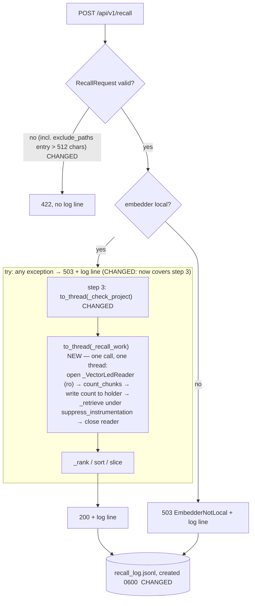

# 004 — Recall hardening from the spec 001 backlog

## Intent
Spec 001 shipped `POST /api/v1/recall` and the `secondbrain-mcp` stdio server. Its tri-review
deferred 14 findings to `docs/optimizations/001-recall-backlog.md`, and two more turned up during
rollout. None is urgent. Together they cover:
- one wasted query per lexical-only candidate;
- one 500 that skips the recall log;
- an unbounded input field;
- a world-readable log of query text;
- a narrow Chroma reconnect race;
- a test that can break `make check` whenever Brent writes a Witt note.

I (Brent) want them closed so recall stays boring: every failure gives a logged 503, the suite is
deterministic, and the eval says only true things. One deliberate exception: a request the client
cancels writes no log line, because `asyncio.CancelledError` is a `BaseException` and is not caught
by the catch-all. This is pinned by a scenario.

Spec 001 is Implemented, which is final, so this spec supersedes these parts of it:
- **Decision 7 step 3:** the project check now runs inside the catch-all, off the event loop.
- **Decision 7 steps 4–6:** counting and retrieval run in one worker call, and the
  `dropped_keyword_only` counting changes (Decision 1 below).
- **The catch-all sentence**, "Any exception in steps 4–11": it now covers steps 3–11.
- **`RecallFilters` validation:** an `exclude_paths` entry can be at most 512 characters.
- **The Evals MRR recommendation:** it is suppressed once the gate is on.
- **Dataset validation:** split into structural rules and corpus rules, and the test
  `test_recall_queries_yaml_validates` no longer fails on corpus drift.

Spec 001 gets a one-line "superseded in part by 004" note under its title. That's a docs-only
edit; its status and history are unchanged.

## Goals
1. **Stop** fetching lexical-only candidates on the recall path, and still count every one of them in `dropped_keyword_only`.
2. **Run** the project-slug check off the event loop and inside the 503 catch-all, so a filesystem error gives a logged 503, not a bare 500.
3. **Open, use and close** the per-request read-only lexical connection inside one worker-thread call, `_recall_work`.
4. **Keep** `witt_chunk_count` and `k_vec` accurate on a 503 log line when retrieval fails after counting.
5. **Reject** an `exclude_paths` entry longer than 512 characters with a 422.
6. **Create** `data/recall_log.jsonl` with mode 0600, and have newsyslog rotate it at 600.
7. **Cancel** the embedder warmup task when the API shuts down.
8. **Close** the Chroma reconnect race: `_reconnect` runs under `_init_lock`, and the `client` / `collection` properties can never return `None`.
9. **Turn** a non-JSON or non-object 200 from the API into eval exit 3 (unreachable), not a traceback.
10. **Record** in the eval report that `embedding_model` and `hf_revision` come from the eval process, not from the API.
11. **Suppress** the `recommend gate_mrr: true` line when the dataset already sets `gate_mrr: true`.
12. **Make** dataset validation deterministic in pytest. Structural rules fail hard. Live-corpus drift is a pytest warning. In the eval, structural and corpus problems still fail with exit 2 and name every reason; a missing or excluded expected file stays a `stale_labels` gate failure (exit 1).
13. **Add** the missing test rows: two snippet-boundary cases, and the cross-folder precondition in the "Witt-only recall returns the best decision first" test.

## Non-Goals
- **Caching the MCP base URL** (backlog Low, "Settings are parsed on every MCP call"). It would save about 1 ms against a network round trip and adds stale-config behaviour. Cut at r1 triage and left on the backlog.
- **Per-request micro-costs** (backlog Low): awaiting the recall-log append, and opening the read-only connection per request. Goal 3 already fuses the two `to_thread` hops; the rest is sub-millisecond. It stays on the backlog.
- **MCP error text echoing the API body** (backlog Low): the body is at the API's own trust level. It stays on the backlog.
- **Exposing the serving API's embedding model**, for example on `/health` or in `RecallResponse`: that would change the response shape. Goal 10 only labels the report honestly. Added to the backlog as a new line.
- **Any change to `HybridRetriever`** (`retrieval/hybrid.py`), to ranking, RRF, the similarity floor, `k_vec` sizing or the recall response shape. `/ask` and every other `retrieve` caller are untouched by construction.
- **Running the dataset drift check from the daily sync.** Deferred unless drift goes unnoticed in practice. See Risks.

## Design


**Decision 1: lexical-only candidates are counted by recall's private reader, never fetched (Goal 1).**
- `_ReadOnlyLexicalStore` becomes `_VectorLedReader`, still private to `api/recall.py`. It overrides `get_chunk(chunk_id)` to increment `self.lexical_only_skipped` and return `None`, without running a query.
- `HybridRetriever.retrieve` calls `get_chunk` only for ids that are not in the vector results, which are exactly the lexical-only ids. It already skips any id whose `get_chunk` returns `None`, and it does this before its `top_k` slice. So the counter holds every lexical-only id in the fused set, whatever `top_k` is.
- Recall sets `dropped_keyword_only = reader.lexical_only_skipped + ranked.dropped_keyword_only`. `_rank` keeps its `similarity_score == 0.0` guard as a belt-and-braces check, and normally adds 0.
- `hybrid.py` is not changed, so `/ask` can't move.
- The 200 hits can't change either: lexical-only candidates were always dropped by `_rank`, and their lexical ranks never contributed to any surviving candidate's RRF score.
- Behaviour difference: before, a lexical-only id whose real `get_chunk` returned `None` was skipped without being counted. Now every lexical-only id is counted. That's accepted; the counter is diagnostic.
- The class docstring must say plainly that `get_chunk` deliberately returns `None`, and why. This store must never be handed to anything except recall's retriever.
- The docstring also notes that a lexical-only id from a store that ignores `include_folders` is now counted in `dropped_keyword_only`, not `dropped_out_of_scope`. That's harmless.
- No `_ReadOnlyLexicalStore` alias is kept. Every test reference is renamed (see Files), so nothing can reach the `None`-returning store under its old, innocent name.
- Test fixture: `LEXONLY_QUERY` runs against a **separate** vault and index built by `build_lexonly_index()` in `tests/fixtures/recall/index.py`. That index has:
  - 4 Witt notes at sim >= 0.40, one of which also matches lexically;
  - 3 Witt notes at sim < 0.40 that match lexically.
  `FIXTURE_VAULT`, its 7 Witt chunks and the TEST_QUERY golden are unchanged.
- Chosen over the r0 design, a new `retrieve_vector_led` method with a shared `_fuse` helper (skeptic r1). That design changed `hybrid.py`, put the `/ask` goldens at risk and broke six existing tests, all to save at most 50 primary-key lookups.

**Decision 2: step 3 moves inside the catch-all; steps 4–5 run in one worker call (Goals 2–4; supersedes spec 001 Decision 7 steps 3–6 and its catch-all sentence).**
- The `try` now starts before `_check_project`, which runs via `asyncio.to_thread`.
- The 503 body stays `recall unavailable: <ExceptionType>`.
- The unknown-project path (a 200 with a warning and no hits) and the vault-missing notice are unchanged.
- **The holder.** A small mutable `_RecallState` (`witt_chunk_count: int = 0`, `lexical_only_skipped: int = 0`) is created in the handler **before** the `try`. It is the only place these values live: there is no `witt_chunk_count` local. `write_log` and `respond` read `holder.witt_chunk_count` and derive `k_vec_for(holder.witt_chunk_count)` from it. A 503 raised from inside `_recall_work` therefore logs whatever was written before the failure (Goal 4).
- New sync function `_recall_work(db_path, build_retriever, query, holder) -> list[RetrievalCandidate]`, run with a single `asyncio.to_thread`:
  1. If `db_path` doesn't exist, return `[]` with the holder untouched (count 0). `mode=ro` can't create the file, so this guard comes before any connection is opened.
  2. Construct a `_VectorLedReader`. In a `try` whose `finally` first copies `reader.lexical_only_skipped` into the holder and then closes the reader:
     - set `holder.witt_chunk_count = reader.count_chunks(["Witt"])`;
     - if that is 0, return `[]`;
     - otherwise call `build_retriever(reader, k_vec_for(count))` and return `_retrieve(retriever, query, k_vec + K_LEX)`.
- `build_retriever` is a closure defined in the handler. It calls the module-global `HybridRetriever(...)` when invoked, not when the module is imported, so the existing `patch.object(recall_module, "HybridRetriever", ...)` patches still take effect.
- `_retrieve` stays as it is: `retrieve(..., include_folders=["Witt"])` under `suppress_instrumentation()`. The existing `spies` fixture keeps working.
- On a 503 the log line's `dropped_keyword_only` is whatever the holder held when the failure happened, normally 0, plus `_rank`'s counter, which is 0 because `_rank` never ran.
- After the call, the handler adds `NOTICE_NO_WITT` / `NOTICE_SATURATED` from the holder as before, then ranks.
- Effect: the reader is opened, used and closed on one worker thread, so a cancelled request can't close it under a running thread, and the two `to_thread` hops become one. The handler has no `reader.close()` of its own.

**Decision 3: input and file hardening (Goals 5 and 6).**
- **Entry length cap.** `RecallFilters._witt_paths_only` checks the `Witt/` prefix first, then rejects any entry over `EXCLUDE_PATH_MAX = 512` characters (characters, not bytes). The message is `exclude_paths entries must be at most 512 characters`.
  - An entry that is both too long and lacks the prefix gets the prefix message.
  - The MCP tool shares `RecallFilters`, so it returns the same text inside `invalid arguments: …`.
  - This supersedes the `RecallFilters` contract in spec 001.
- **Log file mode.** `_append_log` opens the file with `os.open(path, O_WRONLY | O_APPEND | O_CREAT, 0o600)` and wraps the fd with `os.fdopen`. If `fdopen` raises, the fd is closed first.
  - A newly created file is 0600 whatever the process umask.
  - An existing file keeps its mode.
  - An `OSError` from `os.open`, for example `IsADirectoryError`, still gives a WARNING and never reaches the response.
- **Rotation.** The newsyslog line for `recall_log.jsonl` changes its mode from 644 to 600, so rotation doesn't reset it. Rollout installs the conf and chmods the live file and its archives (see Rollout).

**Decision 4: dataset validation splits into structure and corpus (Goal 12; supersedes spec 001's dataset-validation test).**
- `structural_problems(dataset) -> list[str]` covers every rule that reads only the dataset: counts, kinds, filter coverage, near-miss, duplicates. It keeps today's reason strings and order.
- `corpus_problems(dataset, corpus) -> list[str]` returns `verbatim query` and/or `null contamination`, in that order, with today's identifier/short exemptions and Witt-only scoping.
- `validate_dataset(dataset, corpus)` keeps its signature. It joins `structural_problems + corpus_problems` and raises one `DatasetError` naming every reason, so today's contract holds. `run_eval` calls it unchanged, and eval exit 2 is unchanged.
- One shared predicate, `_is_indexed_label(vault_path, expected) -> bool` (the file exists and is not `_is_excluded`). It's used by both the eval's `stale_labels` gate and `check_live_dataset`, so they can't disagree. In the eval, a stale label stays a `stale_labels` failure (exit 1); it is never added to `validate_dataset`.
- New `check_live_dataset(dataset, vault_path) -> list[str]` in `recall_eval`. It returns `corpus_problems(...)` followed by `expected file missing: <path>` for each labelled query that fails `_is_indexed_label`, in dataset order.
  - It issues one `RecallDatasetDriftWarning` (a `UserWarning` subclass) per problem, in the same order.
  - Each warning names the offending term or path, for example `null contamination: 'some-guard-term' in Witt/...md`. The returned strings stay exactly as `corpus_problems` and the missing-file rule produce them.
  - It never raises. With a `vault_path` that doesn't exist, or a vault with no `Witt/`, the corpus is empty and every labelled query is reported as `expected file missing: ...`.
- Pytest:
  - `test_recall_queries_yaml_is_structurally_valid` asserts `structural_problems(committed dataset) == []` and needs no vault.
  - The live-vault test, which still skips with no vault, calls `check_live_dataset` and only warns.
  - `check_live_dataset` itself is tested on temporary vaults.
- This relies on pytest not escalating warnings to errors. `pyproject.toml` has no `filterwarnings` today. Adding `error` would bring back the fragility, so the plan adds a comment there.
- The decision is recorded as an ADR via `note_write`: `make check` no longer gates live-corpus drift, and the eval is the hard gate.

**Decision 5: small, local fixes (Goals 7–11).**
- **Warmup cancellation (Goal 7).** After `yield`, the lifespan reads `task = getattr(app.state, "warmup_task", None)`. If the task exists and isn't done, it calls `task.cancel()` and awaits it under `contextlib.suppress(asyncio.CancelledError)`. Then it sets `app.state.warmup_task = None`. The attribute is touched only when it exists: with warmup disabled, `app.state` never gets a `warmup_task`, so the existing `not hasattr(...)` assertions hold.
  - A finished task is not cancelled.
  - This can't interrupt a model load already running in `to_thread`; the gain is a clean shutdown.
- **Reconnect race (Goal 8).**
  - `_reconnect` runs its body under `with self._init_lock:`.
  - The `client` and `collection` properties each read the attribute once into a local: `c = self._collection`; `if c is None:` take the lock, re-read `c = self._collection`, and `if c is None:` create it and assign `self._collection = c`; then `return c`. Explicit `is None` checks, not truthiness. They never return the attribute after an unlocked check, so a concurrent `_reconnect` can't make them return `None`.
  - `VectorStore.clear()`, which also sets `self._collection = None`, does so under `_init_lock`.
  - `_check_epoch` calls `_reconnect`, so it is covered too.
  - `_init_lock` is already an `RLock`, so a caller that holds it can re-enter.
- **Eval `_post` (Goal 9).** It catches `ValueError` from `resp.json()` and rejects a non-dict payload. Either raises `ApiFailure("recall api returned an invalid body (expected a JSON object): <first 300 chars>")`, giving exit 3 with no report written.
- **Report sources (Goal 10).** The report adds `"model_fields_source": "eval process settings and local HF cache"` next to `embedding_model` and `hf_revision`. Those keys and their values don't change.
- **MRR line (Goal 11).** `recommend = not dataset.gate_mrr and (<existing condition>)`.

## Acceptance Criteria
```gherkin
Feature: Recall hardening

  # --- Golden capture (before any src/ change) --------------------------------

  Scenario: Recall endpoint hits are unchanged by this spec
    Given recall_goldens.json captured by capture_goldens.py on unchanged code
    And it holds, for TEST_QUERY and LEXONLY_QUERY, the recall hits (note_path, chunk_id, round5 score, round5 similarity) unfiltered and with each of project, kinds and exclude_paths
    When the same requests run against the changed code
    Then every hit list equals its golden, with ties sorted by (-round5(score), note_path)

  # --- Goal 1: lexical-only candidates -------------------------------------------

  Scenario: Lexical-only candidates are counted without a chunk query
    Given the LEXONLY fixture: 4 Witt notes at sim >= 0.40, one of which also matches LEXONLY_QUERY lexically, and 3 Witt notes at sim < 0.40 that match LEXONLY_QUERY lexically
    And the reader's connection is traced
    When POST /api/v1/recall runs LEXONLY_QUERY
    Then no "SELECT * FROM chunks WHERE chunk_id" statement is executed
    And the recall log line has dropped_keyword_only == 3
    And the hits are the 4 vector-backed notes

  Scenario: The skip count covers every lexical-only id, whatever top_k is
    Given the LEXONLY fixture and a HybridRetriever built over a _VectorLedReader
    When retrieve(LEXONLY_QUERY, top_k=2, include_folders=["Witt"]) runs
    Then exactly 2 candidates are returned
    And reader.lexical_only_skipped == 3

  Scenario: The private reader still serves count and search
    Given the LEXONLY fixture
    When _VectorLedReader.count_chunks(["Witt"]) and .search(LEXONLY_QUERY) run
    Then count_chunks returns 7 and search returns exactly the 4 lexical-match chunk ids
    And get_chunk returns None for any id

  # --- Goals 2-4: project check, reader lifecycle, 503 log fidelity -------------

  Scenario: Unknown project still returns a 200 with a warning
    Given Witt/Projects/ holds only "witt"
    When recall is called with filters.project "nope"
    Then the status is 200 with no hits
    And warnings contains "unknown project 'nope'; known: witt"
    And _retrieve is not called

  Scenario: A filesystem error in the project check gives a logged 503
    Given _check_project raises PermissionError
    When recall is called with filters.project "witt"
    Then the status is 503 and detail is "recall unavailable: PermissionError"
    And the recall log gets one line with status 503 and error_type "PermissionError"
    And no exception is raised to the ASGI server

  Scenario: The handler offloads exactly one call for the whole read path
    Given asyncio.to_thread in the recall module is spied on
    When recall succeeds with filters.project "witt"
    Then the callables passed to to_thread are exactly [_check_project, _recall_work, _append_log] in that order
    When recall succeeds with no project filter
    Then they are exactly [_recall_work, _append_log]

  Scenario Outline: The reader is closed exactly once on every path
    Given _VectorLedReader.close is spied on
    And the row's precondition
    When recall is called
    Then the status is the row's code
    And close was called exactly once, from a thread that is not the event-loop thread
    And the recall log line has status the row's code

    Examples:
      | precondition                                       | code   |
      | the index is the normal fixture               | 200    |
      | count_chunks raises sqlite3.OperationalError  | 503    |
      | lexical.db holds no Witt chunks               | 200    |
      | _retrieve raises RuntimeError                 | 503    |

  Scenario Outline: No reader is opened when the request stops before counting
    Given _VectorLedReader construction and close are spied on
    And the row's precondition
    When recall is called
    Then the status is 200
    And no _VectorLedReader was constructed and close was called 0 times

    Examples:
      | precondition                                     |
      | filters.project is "nope" (unknown project) |
      | lexical.db does not exist                   |

  Scenario: The private reader is never the shared store
    Given two recall requests are served
    When deps.get_lexical_store() is inspected
    Then type(deps.get_lexical_store()) is LexicalStore
    And its get_chunk for a known chunk id returns the row
    And _VectorLedReader was constructed exactly twice, once per request

  Scenario: A missing lexical.db is still an empty index, not a 503
    Given lexical.db does not exist
    When recall is called
    Then the status is 200 with notice "no Witt notes indexed yet"
    And lexical.db still does not exist

  Scenario: A cancelled request does not close the reader under a running thread
    Given _retrieve blocks on a threading.Event
    When the client request is cancelled through httpx.ASGITransport while _retrieve is blocked
    Then close has not been called while the event is unset
    When the event is set (in a finally, so no worker thread outlives the test)
    Then within 2 s close is called exactly once, from a non-loop thread
    And no recall log line is written for the cancelled request

  Scenario Outline: A 503 after counting logs the real chunk count and window
    Given the injection named in the row's failure column from test_retrieval_failures_return_503_without_leaking_internals
    When recall is called
    Then the status is 503
    And the recall log line has witt_chunk_count == 7 and k_vec == 30

    Examples:
      | failure  |
      | embedder |
      | chroma   |
      | fts      |

  Scenario: A 503 after counting logs a window that actually depends on the count
    Given _VectorLedReader.count_chunks is patched to return 120
    And the "embedder" injection
    When recall is called
    Then the status is 503
    And the recall log line has witt_chunk_count == 120 and k_vec == 120

  Scenario: A 503 during counting logs a zero count
    Given the "count" injection (count_chunks raises)
    When recall is called
    Then the status is 503
    And the recall log line has witt_chunk_count == 0 and k_vec == 30

  Scenario: Recall still writes zero spans with tracing on
    Given tracing is initialised with a span exporter
    When recall succeeds
    Then no span is exported

  # --- Goal 5: exclude_paths cap -------------------------------------------------

  Scenario Outline: The 512-character cap counts characters, not bytes
    Given an exclude_paths entry "Witt/" followed by the row's n copies of the row's ch (é written as "\u00e9" in the test source)
    When recall is called with it
    Then the status is the row's code

    Examples:
      | ch | n   | code   |
      | a  | 507 | 200    |
      | a  | 508 | 422    |
      | é  | 507 | 200    |
      | é  | 508 | 422    |

  Scenario: An over-long entry is rejected with a specific message and no log line
    Given an entry "Witt/" followed by 508 "a" characters
    When recall is called with it in exclude_paths
    Then the status is 422
    And the error message contains "exclude_paths entries must be at most 512 characters"
    And no recall log line is written

  Scenario: The prefix rule wins over the length rule
    Given an entry of 600 "a" characters
    When recall is called with it in exclude_paths
    Then the error message contains "exclude_paths entries must start with 'Witt/'"

  Scenario: The MCP tool reports the cap
    Given the MCP recall tool
    When it is called with an exclude_paths entry of "Witt/" followed by 508 "a" characters
    Then it returns ok false with error containing "invalid arguments" and "at most 512 characters"
    And no HTTP request is sent

  # --- Goal 6: recall log permissions ------------------------------------------

  Scenario: A new recall log is created 0600
    Given no recall_log.jsonl exists and the process umask is set to 0o022 (restored afterwards; the test is marked not parallel-safe)
    When one recall is served
    Then recall_log.jsonl exists with mode 0o600

  Scenario: An existing recall log keeps its mode and is appended to
    Given recall_log.jsonl exists with one line and mode 0o644
    When one recall is served
    Then it has two lines and its mode is still 0o644

  Scenario: A failing fdopen closes the descriptor
    Given recall_module.os.fdopen is patched to raise OSError and os.close is spied on
    When one recall is served
    Then the status is 200
    And a WARNING containing "recall_log write failed" is logged
    And os.close was called once with the fd that os.open returned

  Scenario: A log path that cannot be opened still gives a 200
    Given a directory exists at the recall_log.jsonl path
    When one recall is served
    Then the status is 200
    And a WARNING containing "recall_log write failed" is logged

  Scenario: newsyslog rotates the recall log at mode 600
    Given etc/newsyslog.d/secondbrain.conf
    When the recall_log.jsonl line is parsed
    Then its mode field is "600"

  # --- Goal 7: warmup cancellation ----------------------------------------------

  Scenario: A still-running warmup task is cancelled at shutdown
    Given embedder_warmup is true and the stub embed_single waits on a threading.Event for up to 5 s
    When the app lifespan exits before the event is set
    Then the task captured from app.state.warmup_task has cancelled() == True
    And app.state.warmup_task is None
    And nothing is logged at WARNING
    And the event is set in a finally block so no worker thread outlives the test

  Scenario: A finished warmup is not cancelled at shutdown
    Given embedder_warmup is true and the warmup task is awaited to completion inside the lifespan
    When the lifespan exits
    Then the task has cancelled() == False and exception() is None
    And task.cancel was never called (spied)

  Scenario: Shutdown with warmup disabled is a no-op
    Given embedder_warmup is false
    When the app lifespan exits
    Then no exception is raised
    And app.state has no warmup_task attribute

  Scenario: A failed warmup is still observable
    Given embedder_warmup is true and the stub embed_single raises RuntimeError
    When the task is captured inside the lifespan and awaited
    Then task.exception() is None and a WARNING "Embedder warmup failed" was logged

  # --- Goal 8: reconnect race -----------------------------------------------

  Scenario: _reconnect waits for a thread holding the init lock, then completes
    Given another thread holds VectorStore._init_lock
    When _reconnect is called on a second thread
    Then _client and _collection are unchanged while the lock is held
    When the first thread releases the lock
    Then the second thread finishes within 2 s and _collection is None

  Scenario: _reconnect is re-entrant for a caller that holds the lock
    Given the calling thread holds VectorStore._init_lock
    When it calls _reconnect
    Then _reconnect returns and no exception is raised

  Scenario Outline: Each property reads its attribute only once
    Given a VectorStore subclass whose attribute named in the row's attr column returns the real object on its first read and None on every later read
    When the property named in the row's prop column is accessed
    Then a non-None object is returned

    Examples:
      | attr        | prop       |
      | _collection | collection |
      | _client     | client     |

  Scenario: clear() resets the collection under the init lock
    Given another thread holds VectorStore._init_lock
    When clear() is called on a second thread
    Then _collection is unchanged until the lock is released

  Scenario: Neither property returns None during a concurrent reconnect (smoke test)
    Given a VectorStore over a temporary Chroma directory
    When 2 threads read .collection and 2 threads read .client 200 times each while a fifth calls _reconnect 50 times
    Then every read returns a non-None object
    And no exception is raised

  # --- Goals 9 and 10: eval robustness ----------------------------------------

  Scenario Outline: An invalid 200 body gives exit 3 and no report
    Given the API returns 200 with the row's body on the request named in the row's which column
    When the recall eval runs through Harness.run
    Then the exit code is 3
    And stderr contains "recall api returned an invalid body"
    And no traceback is printed and no report file is written

    Examples:
      | body             | which                  |
      | "oops, not json" | the warmup             |
      | "[]"             | the warmup             |
      | "[{}]"           | the warmup             |
      | "\"str\""        | the warmup             |
      | "oops, not json" | the first eval query   |

  Scenario: The report labels where model fields come from
    Given a passing eval run
    When the report is written
    Then it contains model_fields_source "eval process settings and local HF cache"
    And embedding_model and hf_revision are present and unchanged

  # --- Goal 11: MRR recommendation -----------------------------------------

  Scenario: No MRR recommendation when the gate is already on
    Given a 16-note temporary vault and a dataset with gate_mrr true
    When the eval runs through Harness.run
    Then the report's recommendations is empty
    And stderr does not contain "recommend gate_mrr: true"

  Scenario: The MRR recommendation still prints when the gate is off
    Given a 16-note temporary vault and a dataset with gate_mrr false
    When the eval runs through Harness.run
    Then the report's recommendations is ["recommend gate_mrr: true"]
    And stderr contains "recommend gate_mrr: true"

  # --- Goal 12: dataset validation split -------------------------------------

  Scenario: The committed dataset is structurally valid with no vault
    Given recall_queries.yaml
    When structural_problems runs
    Then it returns []

  Scenario: A structurally broken dataset fails
    Given a dataset with 3 null queries
    When validate_dataset runs with an empty corpus
    Then DatasetError is raised with message containing "too few null"

  Scenario: corpus_problems returns exact reasons in order
    Given a corpus containing a prose query verbatim and a null query's must_not_appear term
    When corpus_problems runs
    Then it returns ["verbatim query", "null contamination"]
    And on a clean corpus it returns []

  Scenario: Corpus exemptions and scoping still hold
    Given the rows of test_validation_exemptions_and_scoping (identifier verbatim, short verbatim, null term only in 10_Notes)
    When corpus_problems runs on each
    Then it returns []

  Scenario: The eval error names every reason across both kinds
    Given a dataset with 3 null queries and a corpus with null contamination
    When validate_dataset runs
    Then DatasetError's message contains both "too few null" and "null contamination"
    And "too few null" appears before "null contamination"

  Scenario: Live drift warns and does not raise
    Given a temporary vault where a Witt note contains a null query's must_not_appear term
    When check_live_dataset runs
    Then a RecallDatasetDriftWarning matching "null contamination" is issued
    And no exception is raised

  Scenario: A missing expected file warns and does not raise
    Given a temporary vault missing one labelled query's expected file
    When check_live_dataset runs
    Then a RecallDatasetDriftWarning matching "expected file missing" is issued
    And no exception is raised

  Scenario: check_live_dataset returns every problem in order, one warning each
    Given a temporary vault with null contamination and one labelled query's expected file missing
    When check_live_dataset runs
    Then it returns exactly ["null contamination", "expected file missing: " plus that path]
    And exactly 2 RecallDatasetDriftWarnings are issued, in that order, the first naming the offending term and note

  Scenario: An excluded expected path is reported the same way by both checks
    Given a labelled query whose expected file exists but sits under Witt/Logs/ (excluded)
    When check_live_dataset runs and the eval scores the run
    Then check_live_dataset reports "expected file missing: " plus that path
    And the eval fails the stale_labels gate with exit 1

  Scenario Outline: check_live_dataset never raises on a broken vault
    Given the row's vault
    When check_live_dataset runs
    Then no exception is raised
    And it returns one "expected file missing: ..." entry per labelled query

    Examples:
      | vault                                  |
      | a vault_path that does not exist       |
      | a vault directory with no Witt/ folder |

  Scenario: A clean vault gives no drift warning
    Given a temporary vault that satisfies every corpus rule and holds every expected file
    When check_live_dataset runs
    Then no RecallDatasetDriftWarning is issued and it returns []

  Scenario: Live-corpus contamination still fails the eval
    Given a temporary vault where a Witt note contains a null query's must_not_appear term
    When the recall eval runs through Harness.run
    Then the exit code is 2
    And stderr contains "invalid dataset" and "null contamination"

  # --- Goal 13: missing test rows ----------------------------------------------

  Scenario: Whitespace exactly at index 600 cuts at 600
    Given a 700-char text whose only whitespace is spaces at indexes 300 and 600
    When make_snippet runs
    Then the snippet is the first 600 characters (a scan starting at 599 would return text[:300])

  Scenario: A whitespace run ending before the cut is found by the backward scan
    Given a 700-char text whose only whitespace is spaces at indexes 590-594
    When make_snippet runs
    Then the snippet is text[:594], which keeps the spaces at 590-593 (no rstrip)

  Scenario: Witt-only recall returns the best decision first, with its precondition checked
    Given the fixture index
    And a default-constructed HybridRetriever's retrieve(TEST_QUERY, top_k=10) ranks "10_Notes/review-process.md" first, as goldens.json["retrieve"] records
    When recall runs TEST_QUERY
    Then the first hit is the ADR-001 overrides decision
```

## Risks & Open Questions
- **The private reader returns `None` from `get_chunk` on purpose.** If it ever reached code that relies on `get_chunk`, that code would see "chunk not found" everywhere. Mitigations:
  - it stays private to `api/recall.py`, with a docstring warning;
  - it's built only inside `_recall_work`;
  - it's never returned or cached;
  - a test pins that it is never `LexicalStore`'s cached instance.
- **The recall goldens are captured from the code we're changing.** If they're captured after a `src/` edit, they prove nothing. The plan's step 1 captures them on unchanged `main`, and the golden test reads the file. A reviewer can check this with git: the golden file must land in its own commit, earlier than any `src/` change.
- **Pytest warnings are easy to ignore** (Decision 4). The eval is now the only hard gate on live drift. Recorded as an ADR. If drift goes unnoticed, the follow-up is running `check_live_dataset` from the daily sync and logging the result.
- **A 0600 log might break a reader.** No other process reads `recall_log.jsonl` today: trace-eval reads `data/traces/`, not this file. Anything added later runs as Brent anyway.
- **The newsyslog conf only matters once it's installed.** This is the same repo-vs-installed drift spec 003 fixed for the UI plist. Rollout includes the sudo copy and a diff.
- **Cancelling warmup during a model load.** `to_thread` can't be interrupted, so shutdown may still wait for the load. That's the same as today, just quieter.
- **The concurrent-reconnect test is probabilistic.** It can pass on broken code if the race window is never hit. The deterministic lock-held scenarios carry the guarantee; the stress test is a smoke check.

## Rollout
1. Merge. The API restarts via the usual `launchctl unload/load` (see PROJECT.md).
2. Confirm which file the running API writes. The installed API plist's `WorkingDirectory` is `/Users/brentrossin/code/second-brain` (checked 2026-11-22), so it writes `data/recall_log.jsonl` there, the path in the newsyslog conf. After a recall, `lsof -p $(lsof -ti:8000) | grep recall_log` shows the open file, if one is open. If it shows a different path, stop: fix the newsyslog conf path before step 4.
3. `cd /Users/brentrossin/code/second-brain && find data -maxdepth 1 -name 'recall_log.jsonl*' -exec chmod 600 {} +`. This covers the live file and any rotated archives, which are renames and keep 644; a plain glob aborts in zsh when no archive exists. Check: `stat -f %Lp data/recall_log.jsonl` prints `600`.
4. Brent, in a real terminal: `sudo cp etc/newsyslog.d/secondbrain.conf /etc/newsyslog.d/`, then `diff etc/newsyslog.d/secondbrain.conf /etc/newsyslog.d/secondbrain.conf` must print nothing.
5. Run the live recall eval. It should still PASS with the same recall@1 and MRR, and no `recommend gate_mrr` line.
6. Undo: revert the merge commit. The 0600 modes are harmless to leave; `chmod 644` restores the old modes if wanted.

## Files
| File | Action | Note |
|---|---|---|
| `src/secondbrain/api/recall.py` | Update | `_VectorLedReader` (`get_chunk` counts and returns None); step 3 inside the try via `to_thread`; `_recall_work` with holder; `dropped_keyword_only` sum; 0600 log open (Decisions 1–3). |
| `src/secondbrain/models.py` | Update | `EXCLUDE_PATH_MAX = 512` in `RecallFilters` validation, prefix rule first (Decision 3). |
| `src/secondbrain/main.py` | Update | Cancel an unfinished warmup task after `yield`, then clear it (Goal 7). |
| `src/secondbrain/stores/vector.py` | Update | `_reconnect` and `clear()` under `_init_lock`; `client` / `collection` read once into locals (Goal 8). |
| `src/secondbrain/eval/recall_eval.py` | Update | `structural_problems`, `corpus_problems`, `_is_indexed_label` (shared with `stale_labels`), `check_live_dataset`, `RecallDatasetDriftWarning`; `_post` body guard; `model_fields_source`; MRR line suppression (Goals 9–12). |
| `etc/newsyslog.d/secondbrain.conf` | Update | `recall_log.jsonl` mode 644 → 600. |
| `pyproject.toml` | Update | Comment under `[tool.pytest.ini_options]` that `filterwarnings = error` would break Decision 4. |
| `tests/fixtures/recall/capture_goldens.py` | Update | Capture `recall_goldens.json` (endpoint hits) and the LEXONLY fixture query. |
| `tests/fixtures/recall/recall_goldens.json` | New | Golden recall hits captured on unchanged code. |
| `tests/fixtures/recall/index.py` | Update | `LEXONLY_QUERY` and `build_lexonly_index()`: a separate vault and index. `FIXTURE_VAULT` is unchanged. |
| `tests/test_recall_api.py` | Update | Goals 1–6 and 13 scenarios. Extend `test_retrieval_failures_return_503_without_leaking_internals` (count == 7), `test_recall_log_write_failure_does_not_fail_the_request` (`os.open` path), `test_snippets_truncated_on_a_word_boundary` (two rows), `test_witt_only_recall_returns_best_decision_first` (precondition), the 422/boundary tables (512 cap). Existing `spies` / `HybridRetriever` patches stay valid because `_retrieve` is unchanged and `build_retriever` looks up `HybridRetriever` at call time. Rename `_ReadOnlyLexicalStore` → `_VectorLedReader` with no alias at the import (line 13), `test_vector_window_covers_every_witt_chunk_up_to_500`, `_inject` (`fts`/`count`), and `test_recall_reads_lexical_db_through_its_own_read_only_connection`, which keeps its `OperationalError, match="readonly"` assert. |
| `tests/test_recall_eval.py` | Update | Goals 9–12. `test_validation_exemptions_and_scoping` moves to `corpus_problems`. The live test calls `check_live_dataset` and only warns. New structural test. `Harness` gets a raw-content responder for the invalid-body rows. |
| `tests/test_mcp_server.py` | Update | MCP row for the 512 cap. |
| `tests/test_embedder_warmup.py` | Update | Goal 7 scenarios. `test_warmup_failure_is_logged_not_raised` captures the task inside the lifespan and keeps its assertion. The `not hasattr` assertions are unchanged. |
| `tests/test_stores.py` | Update | Goal 8 scenarios, including read-once for both properties and `clear()` under the lock. |
| `docs/specs/001-secondbrain-recall-mcp-server-for-witt.md` | Update | One-line "superseded in part by 004" note under the title; status and history untouched. |
| `docs/optimizations/001-recall-backlog.md` | Update | Tick the items closed here; mark MCP-cache as cut at 004 triage; add the "expose serving embedding model" line. |

## Implementation Plan
> **Status:** Approved — ready to execute
>
> **Executor notes:**
> - Always use `uv run python -m pytest`; plain `uv run pytest` resolves to Anaconda's pytest.
> - Work on branch `feat/004-recall-hardening` off `main`. Spec 003 (plist, Approved, quick tier) may be built on the same branch, either first or last, as its own commit.
> - **Step 1.3 is committed on its own, before any `src/` change.** The goldens prove behaviour on unchanged code (Risks).
> - Tests only build stores in `tmp_path`. Never open `data/chroma` or `data/lexical.db` from a test.
> - `hybrid.py` must not change. If any step seems to need it, stop: that contradicts Decision 1.
> - Phase 7 is the live rollout and needs Brent at step 7.3 (sudo).
> - If the spec and the code disagree, stop and propose a spec edit. Don't improvise.

### Phase 1 — Branch, fixtures and goldens on unchanged code
- [x] 1.1 Branch `feat/004-recall-hardening` off `main` and record the suite baseline — files: none — done when: `uv run python -m pytest -q` passes, and the count is written into this step (expected about 1097). **Baseline: 1097 passed (2026-11-22).**
- [x] 1.2 Add `LEXONLY_QUERY` and `build_lexonly_index()` as a separate vault and index (4 Witt notes at sim >= 0.40, one also matching lexically; 3 at sim < 0.40 matching lexically). `FIXTURE_VAULT` is untouched. Add `test_lexonly_fixture_shape`, which asserts 7 Witt chunks, 4 vector hits at the 0.40 floor and 4 lexical matches — files: `tests/fixtures/recall/index.py`, `tests/test_recall_prefilter.py` — done when: that test passes and the existing goldens test still passes.
- [x] 1.3 Extend `capture_goldens.py` to write `recall_goldens.json`: endpoint hits for TEST_QUERY on the session index, and for LEXONLY_QUERY on the LEXONLY index, unfiltered plus each of project, kinds and exclude_paths, with ties sorted. Add `test_recall_endpoint_hits_match_goldens`. **Commit alone** — files: `tests/fixtures/recall/capture_goldens.py`, `tests/fixtures/recall/recall_goldens.json`, `tests/test_recall_api.py` — done when: the test passes on unchanged code and `git show --stat HEAD` lists no `src/` file.

### Phase 2 — Eval and dataset validation (Goals 9–12)
- [x] 2.1 Tests first: the Goal 12 scenarios (structural valid with no vault, structurally broken, exact `corpus_problems` reasons, exemptions and scoping moved to `corpus_problems`, every reason in order, live drift warns, missing expected file warns, excluded path reported by both, never-raises outline, clean vault, exact return plus 2 ordered warnings, contamination still exits 2). Then `structural_problems`, `corpus_problems`, `_is_indexed_label` (also used by `stale_labels`), `check_live_dataset` and `RecallDatasetDriftWarning`. Rewrite the live test to call `check_live_dataset` and warn only — files: `src/secondbrain/eval/recall_eval.py`, `tests/test_recall_eval.py` — done when: all Goal 12 scenarios pass and the existing eval tests pass unchanged.
- [x] 2.2 Tests first: the Goal 9 outline (5 rows, using a new raw-content responder on `Harness`) and the Goal 10 report field. Then the `_post` body guard and `model_fields_source` — files: `recall_eval.py`, `tests/test_recall_eval.py` — done when: those scenarios pass.
- [x] 2.3 Tests first: both Goal 11 scenarios through `Harness.run` with a 16-note vault. Then `recommend = not dataset.gate_mrr and (...)` — files: `recall_eval.py`, `tests/test_recall_eval.py` — done when: both pass.
- [x] 2.4 Add the `pyproject.toml` comment that `filterwarnings = error` would break Decision 4 — files: `pyproject.toml` — done when: `uv run python -m pytest tests/test_recall_eval.py -q` passes and shows the drift warning only when the live vault drifts.

### Phase 3 — Recall reader, worker call and project check (Goals 1–4)
- [ ] 3.1 Rename `_ReadOnlyLexicalStore` → `_VectorLedReader` with no alias. Override `get_chunk` to count and return `None`, with the docstring warnings from Decision 1. Update the four test references. Add the scenarios: lexical-only counted with no chunk query (trace), skip count with top_k=2, the reader still serves count and search, and never the shared store — files: `src/secondbrain/api/recall.py`, `tests/test_recall_api.py` — done when: those 4 scenarios, the read-only test and `test_recall_endpoint_hits_match_goldens` pass.
- [ ] 3.2 Tests first: the to_thread spy scenario, the close-once outline (4 rows), the zero-construction outline (2 rows), the cancelled-request scenario, the 503-after-counting outline (3 rows) plus count=120 and count-fails rows, and a PermissionError in the project check gives a logged 503. Then `_RecallState`, `_recall_work`, the `build_retriever` closure, step 3 inside the `try` via `to_thread`, and the `dropped_keyword_only` sum. Remove the handler's `reader.close()` — files: `api/recall.py`, `tests/test_recall_api.py` — done when: those scenarios, the full `tests/test_recall_api.py` (including the zero-spans and Langfuse tests) and the goldens all pass.

### Phase 4 — Input and log hardening (Goals 5, 6, 13)
- [ ] 4.1 Tests first: the 512-cap outline (4 rows), the specific message, the prefix-wins rule, and the MCP row. Then `EXCLUDE_PATH_MAX` in `RecallFilters` — files: `src/secondbrain/models.py`, `tests/test_recall_api.py`, `tests/test_mcp_server.py` — done when: those scenarios and the existing 422/boundary tables pass.
- [ ] 4.2 Tests first: new log created 0600 (umask restored, not parallel-safe), existing log keeps its mode, failing fdopen closes the fd, and a directory at the path still gives a 200. Then `os.open` / `os.fdopen` in `_append_log` — files: `api/recall.py`, `tests/test_recall_api.py` — done when: those 4 scenarios pass.
- [ ] 4.3 Change the newsyslog mode to 600, plus its parse test — files: `etc/newsyslog.d/secondbrain.conf`, `tests/test_recall_api.py` — done when: "newsyslog rotates the recall log at mode 600" passes.
- [ ] 4.4 Goal 13 rows: snippet whitespace at 300 and 600, the 590–594 run, and the precondition assert against `goldens.json["retrieve"]` — files: `tests/test_recall_api.py` — done when: those rows pass. No `src/` change is expected; if one is needed, `make_snippet` has a bug, so stop and report.

### Phase 5 — Warmup cancellation and the Chroma race (Goals 7, 8)
- [ ] 5.1 Tests first: still-running warmup cancelled, finished warmup not cancelled (cancel spied), disabled warmup leaves no attribute, failed warmup still observable. Update `test_warmup_failure_is_logged_not_raised` so it captures the task inside the lifespan. Then the lifespan change — files: `src/secondbrain/main.py`, `tests/test_embedder_warmup.py` — done when: all warmup tests pass with no hang (each test under 10 s).
- [ ] 5.2 Tests first: `_reconnect` waits for the lock, re-entrancy, the read-once outline (2 rows), `clear()` under the lock, and the concurrent smoke test. Then the locals, the `is None` double-check, and the locked `_reconnect` and `clear` — files: `src/secondbrain/stores/vector.py`, `tests/test_stores.py` — done when: those scenarios pass and `tests/test_stores.py` passes in full.

### Phase 6 — Docs
- [ ] 6.1 Update the backlog: tick the closed items, mark the MCP cache as cut at 004 triage, and add the "expose serving embedding model" line. Confirm 001's superseded note is present — files: `docs/optimizations/001-recall-backlog.md`, `docs/specs/001-secondbrain-recall-mcp-server-for-witt.md` — done when: `grep -c '\- \[x\]' docs/optimizations/001-recall-backlog.md` has gone up by the number of items closed, and 001's status/history are unchanged per `spec_index`.

### Verification
- [ ] V.1 `uv run ruff check src tests` and `uv run ruff format --check src tests` are clean.
- [ ] V.2 `uv run mypy src` is clean.
- [ ] V.3 `uv run python -m pytest -q` is green; paste the summary line. The count should be the Phase 1.1 baseline plus the new tests.
- [ ] V.4 Import smoke test: `uv run python -c "import secondbrain.api.recall, secondbrain.eval.recall_eval, secondbrain.stores.vector, secondbrain.main"` exits 0.
- [ ] V.5 `git diff main --stat -- src/secondbrain/retrieval/hybrid.py` is empty.

### Phase 7 — Rollout (after merge)
- [ ] 7.1 PR merged. API restarted via `launchctl unload/load`. `curl -s http://127.0.0.1:8000/health` returns ok.
- [ ] 7.2 Rollout steps 2–3: confirm the log path, chmod via `find`, and `stat -f %Lp data/recall_log.jsonl` prints `600`.
- [ ] 7.3 **Brent, in a real terminal:** `sudo cp etc/newsyslog.d/secondbrain.conf /etc/newsyslog.d/`, then `diff` prints nothing.
- [ ] 7.4 Live eval: `uv run python -m secondbrain.eval.recall_eval` gives PASS with the same recall@1 and MRR as 2026-11-21 and no `recommend gate_mrr` line.
- [ ] 7.5 One live MCP `recall` call returns `ok: true`, and its `recall_log.jsonl` line shows a `dropped_keyword_only` count.

### Key decisions
| Decision | Rationale |
|---|---|
| Eval split (Phase 2) before the recall changes (Phase 3) | It fixes the one live pain point, the `make check` fragility, first. It touches only `recall_eval.py`, so it is independently mergeable if the later phases stall. |
| Goldens and the LEXONLY fixture in their own commit (1.3) | A golden captured after a `src/` edit proves nothing. A separate commit makes that checkable in git. |
| Reader rename (3.1) before the worker restructure (3.2) | 3.1 is behaviour-neutral for hits, and the goldens verify that. 3.2 then changes only control flow, so a failure points at one change. |
| Spec 003 on the same branch, as its own commit | It's tiny and independent, and one PR means one review pass and one API/UI restart. |
