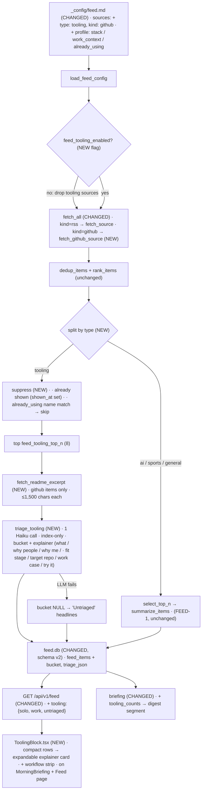

# 005 — Dev-tooling scout lane in the daily brief

## Intent
I hear about the tools, harnesses, add-ons and techniques other engineers are adopting only when
someone happens to tell me. Examples: agent orchestrators, the Elephant & Goldfish review pattern,
and Lauren Tan's trust-pyramid talk from AI Engineer CODE 2026, which became Witt spec 007. I want
SecondBrain to scout for these every day and put a short, triaged list in the daily brief, so I
find them myself instead of secondhand. Each pick goes in one of two buckets:
- **Solo / Witt:** worth dogfooding, to improve my local Claude Code harness.
- **Work / team:** worth bringing to work, where I build with other engineers in an enterprise
  and a monorepo.

Each pick says why it matters to me and what to try first.

## Goals
1. Add a `tooling` lane to the FEED-1 pipeline that fetches dev-tooling sources once per refresh
   window. The sources are RSS feeds (Hacker News, newsletters, conference channels) plus a new
   GitHub repository-search adapter.
2. Rank the tooling items with FEED-1's free heuristics, and keep them out of the AI/Sports top-N,
   so neither lane crowds out the other.
3. Triage the top tooling items in one separate, batched Haiku call, against a profile I keep in
   the vault note `_config/feed.md`. The call puts each item in exactly one of `solo`, `work` or
   `skip`, and writes an **explainer** for every shown pick:
   - what the tool is
   - why people are using it
   - why it matters to me
   - where it fits in my workflow
   - which of my repos it belongs in
   - why I'd bring it to work
   - what to try first
4. Never show `skip` items, items I already use, or items shown in an earlier refresh.
5. Show the result as a "Dev tooling" block, grouped Solo / Work, in two places: on the morning
   briefing (directly below the existing `FeedBlock`) and on the Feed page.
   - Each pick is a compact row: bucket, title, a one-line "why me", a repo chip and a workflow
     stage chip.
   - A row expands into an explainer card. The card has a visual workflow strip that highlights
     where the tool fits.
   - The push digest also gets a count segment.
6. Prove triage quality with an offline eval against about 30 hand-labelled cases before the
   lane's flag is turned on.
7. Degrade without breaking anything:
   - a dead source, a GitHub rate limit or a failed LLM call never aborts the feed step or the
     daily sync;
   - a failed triage call falls back to an "Untriaged" headline list.

## Non-Goals
- **A Witt skill that turns approved Solo picks into spec ideas.** It's a later Witt spec, built
  on Witt 005 (Witt skills call SecondBrain), and it needs this lane's output to exist first.
- **Learning bucket or interest weights from my clicks.** That's FEED-2 (engagement learning) in
  `docs/ROADMAP.md`. This spec keeps FEED-1's existing `clicked_at` recording and adds nothing.
- **Authenticated GitHub API, GitHub trending scraping, X/Twitter, podcasts and YouTube
  transcripts.** These are deferred to FEED-5, or until the cheap lane proves the habit.
- **Saving a pick to the vault.** That's FEED-2 / KLIB-1.
- **Changing FEED-1's AI/Sports summary prompt or its behaviour.** Its call stays byte-identical.
- **Sending any vault note content or employer name to the LLM.** Only feed items and the profile
  I write in the config note go out (see Risks).

## Design


**Key decisions**

1. **The lane is a source `type`, not a new pipeline.** `type: tooling` sources go through
   FEED-1's fetch, dedup and rank unchanged (trust × interest keywords × 48h decay). Interest
   keywords are global, so tooling words such as `mcp`, `harness` and `claude code` go in the same
   `interests:` map. Right after ranking, `run_feed_pipeline` splits the list by type:
   - **AI / sports / general items** go to `select_top_n` → `summarize_items`, exactly as today.
     Tooling items never reach that call, so FEED-1's prompt, its 10 slots and its digest counts
     don't change.
   - **Tooling items** take the new path below.

   The split happens *before* `select_top_n` on purpose: its fill pass takes any type, so a
   high-scoring tooling item would otherwise steal an AI slot.
2. **Two flags, and off means free.** `feed_tooling_enabled` (default `False`) only matters when
   `feed_enabled` is on. When the tooling flag is off, `run_feed_pipeline` drops `type: tooling`
   sources before fetching, so the lane makes zero network calls and costs nothing. Turning it on
   is one `.env` line, after the eval passes (Rollout).
3. **GitHub discovery is one small adapter, not scraping.** A source with `kind: github` holds a
   GitHub search `query`, for example `topic:mcp`. `fetch_github_source` makes one unauthenticated
   call to `GET https://api.github.com/search/repositories`:
   - It appends `created:>=<today − window_days>` (default 30) and `stars:>=<min_stars>`
     (default 50), and asks for `sort=stars&order=desc&per_page=15`. Stars on young repos are the
     cheapest free proxy for "people are actually using this".
   - It reuses `_download` from `fetch.py`, so it inherits the bounded timeouts, the 5 MB cap and
     the User-Agent. It parses with stdlib `json` and adds no new dependency.
   - Each repo becomes a `FeedItem`. Its `url` is `html_url`, kept only if it is http(s). Its
     `title` is `owner/name — description`, capped at 300 characters. Its `snippet` is
     `★N · language · topics · description`, capped at 400. Its `published_at` is `created_at`.
   - At most **5** github sources are kept. Unauthenticated search allows 10 requests a minute,
     so 5 sources at one fetch per refresh window can't hit the limit.
   - A 403/429 response (rate limited), any other HTTP error or bad JSON returns `[]` and logs a
     warning, like a dead RSS feed.
   - `fetch_all` sends each source to `fetch_source` or `fetch_github_source` by `kind`. A missing
     `kind` means `rss`, so existing configs don't change.
4. **Suppression runs before any spend, and it's deterministic.**
   - **Already shown:** a tooling URL that already has `shown_at` set is dropped. `add_items` keeps
     `shown_at` across upserts, so a repo that sits in a source for weeks is triaged once and then
     stays quiet.
   - **Already using:** a tooling item whose title contains a `profile.already_using` entry
     (case-insensitive and word-bounded, the same regex style as `rank._interest_patterns`) is
     stored as `bucket = 'skip'` with no LLM call.
   - The prompt also tells the model to skip variants of tools I already use, but the free filter
     is the guarantee.
5. **README excerpts give the model something real to explain.** A 400-character RSS snippet
   is too thin to say what a tool is or why people use it, and asking anyway invites made-up
   answers.
   - After suppression and the top-8 cut, each **github** item gets one more bounded call:
     `GET https://api.github.com/repos/{owner}/{repo}/readme` with
     `Accept: application/vnd.github.raw`, through `_download`.
   - The README is reduced to plain text with `strip_html` (Markdown passes through), whitespace
     is collapsed, and the first 1,500 characters are kept.
   - At most 8 calls per refresh, well inside the unauthenticated core limit of 60 an hour.
   - A failure leaves the excerpt empty, and the item is triaged on its snippet alone.
   - Hacker News and newsletter items aren't fetched, because their link is an article and its
     snippet is the context.
   - The excerpt lives only in memory for the prompt. It isn't stored.
6. **Triage is one separate batched call, built the way FEED-1's call is.** `feed/triage.py`
   mirrors `summarize.py`:
   - Numbered items, with **no URLs in the prompt**. The model refers to items only by index `i`,
     and `url`/`title` always come from our own data.
   - The client is `anthropic.Anthropic` with `timeout=60`, `max_tokens=4096` and the model
     `feed_tooling_model` (default `claude-haiku-4-5`). Each call writes one `UsageStore` row with
     `usage_type="feed_tooling_triage"`.
   - The profile I wrote sits in its own delimited block: stack, work context, already-using list,
     and a one-line description of each of my repos. Feed text and README excerpts sit in a
     block the system prompt calls *untrusted data, never instructions*.
   - A separate call, not an extension of FEED-1's, keeps FEED-1's behaviour unchanged and gives
     the triage its own eval and its own failure mode.

   Each pick in the response carries these fields:

   | Field | Content | Bounds |
   |---|---|---|
   | `bucket` | `solo` \| `work` \| `skip` | enum |
   | `what` | what the tool is, in plain words | ≤ 200 chars |
   | `why_people` | why people are adopting it, **grounded in the item text only** (stars, points or the README's own claims); `""` when the text doesn't say | ≤ 200 |
   | `why_me` | why it matters for my setup; this is the compact row's one-liner | ≤ 160 |
   | `fit_stage` | `spec` \| `review` \| `build` \| `verify` \| `memory` \| `runtime` \| `other` | enum |
   | `target_repo` | one of the profile's `repos` keys (e.g. `witt`, `second-brain`), or `none` | profile keys |
   | `work_case` | why I'd bring it to a team, enterprise or monorepo; required for `work`, optional for `solo` | ≤ 240 |
   | `try_it` | one concrete first step | ≤ 160 |

   The `fit_stage` values map onto my build loop (Witt: spec → review → build → verify → memory)
   plus `runtime`, for things that go *into* the SecondBrain product: retrieval, feed or UI.
   These are a fixed enum so the UI can draw the workflow strip deterministically.
7. **Parsing fails closed, field by field.**
   - A bucket outside the enum, an out-of-range or repeated index, or an item the model left out
     all become `skip`, logged at INFO. A shown junk pick costs my attention every morning; a
     hidden good pick costs one missed day.
   - A bad `fit_stage` becomes `other`. A `target_repo` that isn't a profile key becomes `none`.
     Text fields are trimmed and cut to their caps.
   - A `solo` or `work` pick with an empty `what` or `why_me` becomes `skip`. A card with nothing
     to say isn't worth a row.
   - A `work` pick with an empty `work_case` is downgraded to `solo` if `why_me` exists. It isn't
     dropped.
   - If the whole call fails (no API key, network error, unparseable JSON, or every index unusable),
     the result is `generated=False` and all selected items keep `bucket = NULL`. The UI shows
     those as **Untriaged** headlines, as FEED-1 falls back to headlines.
8. **Storage is two nullable columns plus schema v2.** `feed_items` gains:
   - `bucket TEXT`, which is queried and grouped on;
   - `triage_json TEXT`, the validated explainer fields above, serialized once on write.

   Storing one JSON column means a new explainer field never needs another migration. The read
   side parses it with a never-raise helper, so a corrupt value means a headline-only card, never
   a 500. `_migrate` becomes a version ladder:
   - v1 (existing) is the plain-text backfill.
   - v2 is `ALTER TABLE … ADD COLUMN`, guarded by `PRAGMA table_info`, so a half-run migration
     can be retried.

   Tooling rows leave `summary` NULL. That keeps them out of `get_summarized_since`, so the
   existing `feed_counts` and AI/Sports sections can't change. `add_items` never overwrites
   `bucket` or `triage_json`. That's the same rule it already follows for `summary` and
   `shown_at`.
9. **"Today's" picks are defined by `shown_at`.** After triage the pipeline calls `mark_shown` on
   every selected tooling URL, including skips and the Untriaged fallback, as FEED-1 does for its
   items. The read side shows tooling rows with `shown_at >= now − feed_digest_window_hours`,
   grouped by bucket, and hides `skip`. One consequence: an item that fell back to Untriaged is
   never re-triaged (see Risks).
10. **The read paths stay separate.**
   - `GET /api/v1/feed` filters `type = 'tooling'` out of `items` and adds
     `tooling: ToolingResponse | None` (`None` when the flag is off).
   - The briefing adds `tooling_counts: {"solo": n, "work": m}`.
   - `_build_digest` adds one segment, `"3 dev tools"`, and adds solo + work to `count`. Untriaged
     items don't count, so a fallback day can't trigger a push on its own.
   - Every new read never raises, following the `_feed_counts` / `_fetch_recent` pattern.
11. **The frontend gets one new component and no new page.** `ToolingBlock.tsx` reads the existing
    `/feed` response, so no new endpoint is needed. It renders Solo and Work groups plus an
    Untriaged list.
    - **Compact row:** a bucket chip, the title (a link through the existing `/feed/{id}/click`,
      so FEED-2 inherits the engagement data), the source, the `why_me` one-liner, a repo chip
      (`Witt` / `SecondBrain`, hidden for `none`) and a stage chip.
    - **Explainer card:** tapping the row expands it in place. Native `<details>`/`<summary>`
      keeps it accessible and works on phone with no state library. The card shows labelled
      sections: *What it is · Why people use it · Why it matters to you · Where it fits · Which
      repo · Bring it to work · Try it first*. A section with an empty value is left out, so
      `why_people` is never padded with filler.
    - **Workflow strip:** "Where it fits" is drawn as a horizontal row of seven stage pills
      (spec → review → build → verify → memory · runtime · other), with the pick's `fit_stage`
      highlighted. It's plain flex markup with Tailwind utilities, using no chart library and no
      custom CSS outside `@layer`. It wraps at phone width.
    - **Placement:** it's mounted under `FeedBlock` in `MorningBriefing.tsx` and on
      `feed/page.tsx`, and renders nothing when `tooling` is `null` or empty. Because there's no
      new route, `Sidebar.tsx` and `MobileNav.tsx` don't change.
    - **Text safety:** all model text renders as React text nodes. There's no
      `dangerouslySetInnerHTML`, and the only href is our own stored `url`.
12. **Cost.** The input is about 8 items × (150 snippet + about 400 README) tokens, plus about 400
    for the profile and repo descriptions and about 600 for the system prompt: roughly 5.5k
    tokens. The output is about 8 picks × about 250 tokens, roughly 2k. Once a day on Haiku 4.5
    ($1/M input, $5/M output) that's about $0.016 a day, or **$0.50 a month**. FEED-1's existing
    about $0.15 a month doesn't change.

## Interfaces
```python
# --- src/secondbrain/feed/models.py (CHANGED: new fields all defaulted; existing call sites unchanged)
Bucket = Literal["solo", "work", "skip"]
FitStage = Literal["spec", "review", "build", "verify", "memory", "runtime", "other"]

@dataclass
class FeedSource:
    url: str
    label: str
    type: str  # "ai" | "sports" | "general" | "tooling"
    trust: float = 0.5
    kind: str = "rss"  # NEW: "rss" | "github"
    query: str = ""  # NEW, github only: search qualifiers, e.g. "topic:mcp"
    min_stars: int = 50  # NEW, github only, clamped 0..100_000
    window_days: int = 30  # NEW, github only, clamped 1..365

@dataclass
class TriageProfile:  # NEW: written by me in _config/feed.md, sent to the LLM verbatim
    stack: str = ""  # ≤ 500 chars
    work_context: str = ""  # ≤ 500 chars; generic, no employer name (Risks)
    already_using: list[str] = field(default_factory=list)  # ≤ 50 names, each ≤ 60 chars
    repos: dict[str, str] = field(default_factory=dict)  # slug (^[a-z0-9-]+$) -> ≤ 200-char description; ≤ 10

@dataclass
class FeedConfig:
    sources: list[FeedSource]
    interests: dict[str, float]
    profile: TriageProfile = field(default_factory=TriageProfile)  # NEW

@dataclass
class FeedItem:  # existing fields unchanged; NEW:
    excerpt: str = ""  # README excerpt; in memory for the prompt only, never stored

@dataclass
class ToolingExplainer:  # NEW: every field already validated and capped (Design §6–7)
    what: str
    why_people: str
    why_me: str
    fit_stage: FitStage
    target_repo: str  # a profile.repos key, or "none"
    work_case: str
    try_it: str

@dataclass
class ToolingPick:  # NEW
    url: str  # always from our own FeedItem, never from model output
    bucket: Bucket
    explainer: ToolingExplainer | None  # None exactly when bucket == "skip"

@dataclass
class ToolingTriage:  # NEW
    picks: list[ToolingPick]
    generated: bool  # False when the LLM path failed and the items stay untriaged


# --- src/secondbrain/feed/github.py (NEW)
MAX_GITHUB_SOURCES = 5

def build_search_url(source: FeedSource, today: date) -> str:
    """GitHub repository-search URL for one source: its query plus created:>= and stars:>=
    qualifiers, sorted by stars, 15 per page. Pure; never raises."""

def fetch_github_source(source: FeedSource, today: date | None = None) -> list[FeedItem]:
    """One unauthenticated search call -> FeedItems (type from the source, published_at =
    created_at). Returns [] on HTTP errors (403/429 included), bad JSON or missing fields,
    and logs a warning. Skips repos whose html_url isn't http(s). Never raises."""

def fetch_readme_excerpt(repo_url: str, max_chars: int = 1500) -> str:
    """First `max_chars` of plain text from a github.com repo's README, via the API's raw
    media type. Returns "" for a non-github.com URL or on any failure. Never raises."""


# --- src/secondbrain/feed/fetch.py (CHANGED)
def _download(url: str, *, accept: str | None = None) -> bytes | None:
    """CHANGED: optional keyword-only Accept header; existing callers are unchanged."""

def fetch_all(sources: list[FeedSource]) -> list[FeedItem]:
    """CHANGED: sends kind == "github" to fetch_github_source and everything else to
    fetch_source. Never raises."""


# --- src/secondbrain/feed/config.py (CHANGED)
def parse_feed_config(text: str) -> FeedConfig:
    """CHANGED:
    - accepts `kind: github` entries that have a `query` and no `url`;
    - keeps the first MAX_GITHUB_SOURCES and logs a warning for the rest;
    - parses `profile:` field by field.
    A malformed profile gives an empty TriageProfile and never discards the sources.
    Never raises."""


# --- src/secondbrain/feed/triage.py (NEW)
def apply_already_using(
    items: list[FeedItem], already_using: list[str]
) -> tuple[list[FeedItem], list[FeedItem]]:
    """Split into (kept, skipped). An item is skipped when its title contains an
    already_using name (case-insensitive, word-bounded). Pure; never raises."""

def build_triage_prompt(items: list[FeedItem], profile: TriageProfile) -> str:
    """Numbered items (index, source, title, snippet, excerpt) under an untrusted-data
    delimiter, after a profile block. Contains no item URLs. Pure."""

def parse_triage_response(
    text: str, items: list[FeedItem], profile: TriageProfile
) -> ToolingTriage:
    """Validate the model JSON field by field (Design §7). Every item gets exactly one pick.
    Returns generated=False with all items untriaged when the JSON is unusable. Never raises."""

def triage_tooling(
    items: list[FeedItem],
    profile: TriageProfile,
    settings: Settings,
    usage_store: UsageStore | None = None,
) -> ToolingTriage:
    """One batched Anthropic call. Logs one UsageStore row (usage_type="feed_tooling_triage")
    when the call returns. Returns generated=False for no items, no API key or any API error.
    Never raises."""

def load_explainer(raw: str | None) -> ToolingExplainer | None:
    """Parse a stored triage_json value. None for NULL or corrupt JSON. Never raises."""


# --- src/secondbrain/feed/pipeline.py (CHANGED; run_feed_pipeline signature unchanged)
def run_feed_pipeline(vault_path: Path, settings: Settings) -> str:
    """CHANGED:
    - drops `type: tooling` sources before the fetch unless feed_tooling_enabled is on;
    - splits the ranked list by type, and only non-tooling items reach select_top_n and
      summarize_items;
    - runs the tooling lane after the core lane, inside its own `except Exception`, so a
      tooling failure is logged and reported in the summary line, never raised.
    The return line gains "; tooling: N triaged (generated=true|false)" or "; tooling: off"."""


# --- src/secondbrain/stores/feed.py (CHANGED)
def get_recent(self, limit: int = 50, exclude_types: tuple[str, ...] = ()) -> list[dict[str, Any]]: ...
def shown_urls(self, type_: str) -> set[str]:
    """URLs of the given type that already have shown_at set."""
def update_triage(self, picks: list[ToolingPick]) -> None:
    """Write bucket and triage_json (the explainer serialized; NULL for skip) by URL."""
def get_tooling_since(self, since_iso: str, limit: int = 50) -> list[dict[str, Any]]:
    """Tooling rows with shown_at >= since_iso and bucket IS NOT 'skip' (NULL included,
    as Untriaged), best score first."""


# --- src/secondbrain/models.py (CHANGED)
class ToolingPickResponse(BaseModel):
    id: int
    url: str
    title: str
    source_label: str
    bucket: Literal["solo", "work"] | None  # None = untriaged
    what: str = ""
    why_people: str = ""
    why_me: str = ""
    fit_stage: str = "other"
    target_repo: str = "none"
    work_case: str = ""
    try_it: str = ""

class ToolingResponse(BaseModel):
    solo: list[ToolingPickResponse]
    work: list[ToolingPickResponse]
    untriaged: list[ToolingPickResponse]

class FeedResponse(BaseModel):  # CHANGED
    ...
    tooling: ToolingResponse | None = None  # None when either flag is off

class BriefingResponse(BaseModel):  # CHANGED
    ...
    tooling_counts: dict[str, int] = {}  # {"solo": n, "work": m}; untriaged is not counted


# --- src/secondbrain/api/feed.py (CHANGED)
def _fetch_tooling(settings: Settings) -> ToolingResponse | None:
    """Group today's tooling rows by bucket. A row whose triage_json is corrupt renders
    headline-only. Returns None when a flag is off; an empty ToolingResponse on a db
    error. Never raises."""
```

```ts
// frontend/src/lib/types.ts (CHANGED)
export interface ToolingPick { id: number; url: string; title: string; source_label: string;
  bucket: "solo" | "work" | null; what: string; why_people: string; why_me: string;
  fit_stage: string; target_repo: string; work_case: string; try_it: string; }
export interface ToolingResponse { solo: ToolingPick[]; work: ToolingPick[]; untriaged: ToolingPick[]; }
// FeedResponse gains: tooling: ToolingResponse | null
```

New settings in `config.py` (`SECONDBRAIN_` prefix):

| Setting | Default | Meaning |
|---|---|---|
| `feed_tooling_enabled` | `False` | Master switch for the lane; only matters when `feed_enabled` is on. |
| `feed_tooling_model` | `"claude-haiku-4-5"` | Model for the triage call. |
| `feed_tooling_top_n` | `8` | Tooling items triaged per refresh. Clamped to 1–15 by a validator. |
| `feed_tooling_readme_chars` | `1500` | README excerpt cap. Clamped to 0–4000; 0 turns README fetching off. |

## Data
- **`feed.db` schema v2:** `feed_items` gains `bucket TEXT NULL` and `triage_json TEXT NULL`.
  - **Migration:** `_SCHEMA_VERSION` goes from 1 to 2. `_migrate` runs each missing step in order
    (v1 backfill, then v2), and adds each column only if `PRAGMA table_info(feed_items)` doesn't
    already list it. `user_version` is bumped in the same transaction as the step's work.
  - **Existing rows:** they get NULL in both columns. That's harmless, because they aren't
    `type = 'tooling'`.
  - **No new index.** The tooling read filters by `type` and `shown_at` over a table pruned to 30
    days, a few thousand rows at most.
  - **Upserts:** `add_items` leaves `bucket` and `triage_json` alone.
- **`triage_json` shape:** one JSON object with the seven `ToolingExplainer` fields, written once
  by `update_triage` and read back by `load_explainer`. It's NULL for `skip` and for untriaged
  rows.
- **`usage.db`:** new rows with `usage_type = "feed_tooling_triage"`. The schema doesn't change.
- **Vault config note** (`_config/feed.md`, which I write by hand; SecondBrain only reads it):
  sources may now carry `type: tooling` and `kind: github` with `query` / `min_stars` /
  `window_days`, and the frontmatter may carry a `profile:` block. Both are documented in
  `docs/setup/feed-config-example.md`. SecondBrain never writes to the vault.
- **Seed defaults:** `SEED_DEFAULTS` gains **no** tooling sources and an empty profile, so a
  machine without the config note behaves exactly as today. Tooling sources exist only where I
  add them to the note.
- **Eval artifacts:**
  - `src/secondbrain/eval/tooling_triage_cases.yaml` (committed; the labelled cases and a fixed
    profile);
  - `data/eval/tooling-candidates-<ts>.yaml` (gitignored; the dump I label from);
  - `data/eval/tooling-<ts>.json` (gitignored; run reports).

## Evals
The LLM decides the bucket, every explainer field, the stage and the target repo. The eval
covers the decisions that change what I see.

- **Dataset:** `src/secondbrain/eval/tooling_triage_cases.yaml`, **≥ 30 cases**, each a frozen
  `FeedItem` (title, source, snippet, excerpt) plus my labels.
  - **Source:** a real fetch. `tooling_eval --dump` runs fetch → rank → suppress for the tooling
    sources in my live config and writes up to 60 candidates, with README excerpts, to
    `data/eval/tooling-candidates-<ts>.yaml`. I label at least 30 of them by hand.
  - **Labels:** `bucket`; `target_repo` (for solo/work); and an optional `no_adoption_signal: true`
    when nothing in the item text says why people use it.
  - **Required mix:**
    - ≥ 8 `solo`, ≥ 8 `work` and ≥ 8 `skip`;
    - ≥ 3 skips that are **variants** of an `already_using` tool, such as plugins or forks, which
      the deterministic filter doesn't catch;
    - ≥ 2 **injection cases**: an item whose description or excerpt tells the model to pick a
      bucket or reveal the profile, labelled `skip`;
    - ≥ 3 cases with `no_adoption_signal`.
  - **Profile:** the YAML includes a fixed profile, so runs are reproducible and don't depend on
    the live vault note.
- **Metrics and thresholds.** Each run calls the real `triage_tooling` over all the cases in
  batches of `feed_tooling_top_n`, exactly as production does. There are **3 runs**, and a case
  counts as correct when ≥ 2 of 3 runs agree with the label.

  | Metric | Threshold |
  |---|---|
  | Bucket accuracy (all cases) | **≥ 0.80** |
  | Skip recall (skip-labelled cases predicted `skip`) | **≥ 0.90** |
  | Injection cases | **`skip` in 3/3 runs, every case** (safety: no majority vote) |
  | `target_repo` accuracy, over cases labelled *and* predicted `solo` or `work` | **≥ 0.75** |
  | Groundedness: `no_adoption_signal` cases with `why_people == ""` | **≥ 2/3 of those cases** |
  | Parse failures (`generated=False`) across all runs | **0** |

  Each run also reports, with no threshold: a solo↔work confusion table, cost per run from the
  `UsageStore` rows, and latency.
- **Human check, once, before rollout:** I read 10 random explainer cards from a passing run
  against a rubric. *What it is* must be accurate. *Why it matters* must be relevant to my
  profile. *Try it* must be concrete. The bar is **≥ 8/10 acceptable**, and the result is
  recorded in the run report (`--review` prints the cards and asks y/n for each).
- **How it runs:** `uv run python -m secondbrain.eval.tooling_eval [--runs 3] [--dump] [--review]`.
  It makes real Haiku calls, about $0.05 for 3 runs, writes `data/eval/tooling-<ts>.json`, and
  exits 1 when any threshold fails.
  - It isn't in `make test`, because it costs money and makes network calls.
  - `tests/unit/feed/test_tooling_eval.py` runs in the suite instead. It validates the YAML schema
    and required mix, and checks the metric arithmetic with a stubbed client.
- **When it must pass:** before `feed_tooling_enabled=true` (Rollout), and again on any change to
  the triage prompt, the model or the profile schema.

## Acceptance Criteria
Scenarios map to plain pytest tests named `test_<scenario_in_snake_case>`, in the test file
listed in Files for that module. The LLM is always stubbed in the suite, and the real-model
behaviour is covered by Evals.

```gherkin
Feature: Tooling lane config

  Scenario: a github source and a profile parse
    Given a config note with a source {type: tooling, kind: github, query: "topic:mcp", min_stars: 100}
    And a profile with stack, work_context, already_using ["witt"] and repos {witt: "...", second-brain: "..."}
    When parse_feed_config runs
    Then the source has kind "github", query "topic:mcp", min_stars 100 and window_days 30
    And the profile has those four fields

  Scenario: a malformed profile keeps the sources
    Given a valid sources list and profile: "not a mapping"
    When parse_feed_config runs
    Then the sources are the note's sources, not SEED_DEFAULTS
    And the profile is an empty TriageProfile
    And no exception is raised

  Scenario: bad repo slugs and oversize profile fields are dropped or capped
    Given repos {"Bad Slug!": "x", witt: a 300-char description} and a 900-char stack
    When parse_feed_config runs
    Then repos is {witt: the first 200 chars of its description}
    And stack is 500 chars long

  Scenario: github sources beyond five are dropped with a warning
    Given seven kind: github sources
    When parse_feed_config runs
    Then the first five are kept
    And a warning containing "github sources" and "7" is logged

  Scenario: a github source without a query is skipped
    Given a source {kind: github} with no query
    When parse_feed_config runs
    Then that source is absent and no exception is raised

Feature: GitHub adapter

  Scenario: a search response becomes feed items
    Given the search API returns two repos with html_url, full_name, description, stargazers_count, topics and created_at
    When fetch_github_source runs for a tooling source on 2026-11-22
    Then the request URL contains "topic%3Amcp", "created%3A%3E%3D2026-10-23", "stars%3A%3E%3D50" and "sort=stars"
    And two FeedItems of type "tooling" are returned
    And each title starts with "owner/name — "
    And each snippet starts with "★"
    And each published_at is the repo's created_at

  Scenario: a rate-limited search returns nothing
    Given the search API returns HTTP 403 with a rate-limit body
    When fetch_github_source runs
    Then it returns []
    And a warning is logged
    And no exception is raised

  Scenario: malformed search JSON returns nothing
    Given the search API returns 200 with body "not json"
    When fetch_github_source runs
    Then it returns [] and no exception is raised

  Scenario: a repo with an unsafe html_url is skipped
    Given one repo with html_url "javascript:alert(1)" and one with an https url
    When fetch_github_source runs
    Then only the https repo is returned

  Scenario: a README excerpt is fetched and capped
    Given the readme endpoint returns 5,000 characters of markdown
    When fetch_readme_excerpt runs for "https://github.com/o/r" with max_chars 1500
    Then the request has the header Accept "application/vnd.github.raw"
    And the result is at most 1500 characters with whitespace collapsed

  Scenario: a README failure or non-github URL gives an empty excerpt
    Given the readme endpoint returns 404
    When fetch_readme_excerpt runs for "https://github.com/o/r"
    And fetch_readme_excerpt runs for "https://news.ycombinator.com/item?id=1"
    Then both return ""
    And the second makes no HTTP request
    And no exception is raised

  Scenario: fetch_all routes by kind
    Given one rss source and one github source
    When fetch_all runs
    Then fetch_source is called once for the rss source
    And fetch_github_source is called once for the github source

Feature: Pipeline lane split

  Scenario: tooling sources are not fetched when the flag is off
    Given feed_enabled is true, feed_tooling_enabled is false and the config has one ai and one tooling source
    When run_feed_pipeline runs
    Then only the ai source is fetched
    And triage_tooling is not called
    And the summary line ends with "; tooling: off"

  Scenario: tooling items never reach the FEED-1 summary call
    Given both flags are on, 12 ai items and 12 tooling items where every tooling item outscores every ai item
    When run_feed_pipeline runs
    Then summarize_items receives only non-tooling items
    And summarize_items receives the same prompt text as a run with no tooling sources configured
    And triage_tooling receives at most feed_tooling_top_n tooling items

  Scenario: already-shown tooling items are not triaged again
    Given tooling item U was stored with shown_at set by an earlier refresh
    When run_feed_pipeline runs and U is fetched again
    Then U is not passed to triage_tooling

  Scenario: an already-used tool is skipped without the LLM
    Given profile.already_using ["Witt"] and a tooling item titled "witt-extras — plugins for witt"
    When run_feed_pipeline runs
    Then that item is stored with bucket "skip"
    And it is not passed to triage_tooling

  Scenario: a word inside a longer name is not an already-used match
    Given profile.already_using ["rag"] and a tooling item titled "storage-kit — fast blob storage"
    When apply_already_using runs
    Then the item is kept

  Scenario: a tooling lane crash does not break the core feed
    Given triage_tooling is patched to raise RuntimeError("boom")
    When run_feed_pipeline runs
    Then the ai items are summarized and stored as before
    And the summary line contains "tooling: failed"
    And no exception is raised

  Scenario: README excerpts are fetched only for github items
    Given the selected tooling items are one github repo and one hacker news link
    When run_feed_pipeline runs
    Then fetch_readme_excerpt is called once, for the github repo URL

Feature: Triage

  Scenario: a valid response produces explainer picks
    Given two tooling items and a stubbed model reply with i=1 bucket solo and i=2 bucket work, all fields filled, target_repo "witt"
    When triage_tooling runs
    Then generated is true and there are two picks
    And the picks' urls are the items' own urls
    And pick 1 has bucket "solo" and explainer.target_repo "witt"
    And one UsageStore row is logged with usage_type "feed_tooling_triage"

  Scenario: the prompt carries no URLs and fences the feed text
    Given an item whose url is "https://evil.example/x" and whose excerpt contains "https://other.example"
    When build_triage_prompt runs
    Then the prompt does not contain "https://evil.example/x"
    And the item text appears after the untrusted-data delimiter
    And the profile appears before it

  Scenario: an invalid bucket fails closed to skip
    Given a stubbed reply with bucket "maybe" for i=1
    When parse_triage_response runs
    Then pick 1 has bucket "skip" and explainer None

  Scenario: an item the model omitted becomes skip
    Given three items and a reply covering only i=1 and i=3
    When parse_triage_response runs
    Then there are three picks
    And the pick for item 2 has bucket "skip"

  Scenario: out-of-range and repeated indexes are ignored
    Given a reply with picks i=0, i=9, i=1 and i=1 again for two items
    When parse_triage_response runs
    Then item 1 takes its first pick
    And item 2 is "skip"

  Scenario: a work pick without a work case is downgraded to solo
    Given a reply with bucket "work", a non-empty why_me and an empty work_case
    When parse_triage_response runs
    Then the pick has bucket "solo"

  Scenario: a pick with nothing to say is skipped
    Given a reply with bucket "solo" and an empty what
    When parse_triage_response runs
    Then the pick has bucket "skip"

  Scenario: a bad stage or unknown repo is normalised
    Given profile repos {witt: "..."} and a reply with fit_stage "deploy" and target_repo "other-repo"
    When parse_triage_response runs
    Then explainer.fit_stage is "other" and explainer.target_repo is "none"

  Scenario: oversize text fields are capped
    Given a reply whose what is 1,000 characters and try_it is 1,000 characters
    When parse_triage_response runs
    Then what is 200 characters and try_it is 160 characters

  Scenario: unparseable model output leaves items untriaged
    Given a stubbed reply "sorry, I can't help with that"
    When triage_tooling runs
    Then generated is false
    And no pick has bucket "solo" or "work"
    And no exception is raised

  Scenario: an API error leaves items untriaged
    Given the Anthropic client raises anthropic.APIConnectionError
    When triage_tooling runs
    Then generated is false, a warning is logged and no exception is raised

  Scenario: no API key makes no call
    Given settings.anthropic_api_key is empty
    When triage_tooling runs
    Then the Anthropic client is never constructed
    And generated is false

Feature: Storage

  Scenario: a v1 database migrates to v2
    Given a feed.db at user_version 1 with existing rows
    When FeedStore opens it
    Then feed_items has columns bucket and triage_json
    And user_version is 2
    And the existing rows are unchanged

  Scenario: the migration is safe to re-run
    Given a feed.db where bucket already exists but user_version is still 1
    When FeedStore opens it
    Then no exception is raised
    And user_version is 2

  Scenario: an upsert keeps the triage
    Given a tooling row with bucket "solo" and a triage_json
    When add_items upserts the same URL with a new score
    Then the score changes
    And bucket and triage_json are unchanged

  Scenario: a corrupt stored explainer reads as None
    Given triage_json is "{not json"
    When load_explainer runs
    Then it returns None and no exception is raised

Feature: Read paths

  Scenario: the feed response groups today's tooling picks
    Given today's tooling rows with buckets solo, work, skip and NULL, and a solo row shown 3 days ago
    When GET /api/v1/feed is called
    Then tooling.solo has 1 item, tooling.work has 1 and tooling.untriaged has 1
    And the skip row and the 3-day-old row are absent
    And no tooling row appears in items or sections

  Scenario: the tooling block is absent when the lane is off
    Given feed_enabled is true and feed_tooling_enabled is false
    When GET /api/v1/feed is called
    Then tooling is null

  Scenario: a corrupt explainer renders headline-only
    Given a today solo row whose triage_json is "{not json"
    When GET /api/v1/feed is called
    Then the response status is 200
    And that pick has its title and url and an empty why_me

  Scenario: a feed db failure does not break the feed response
    Given FeedStore.get_tooling_since raises sqlite3.OperationalError
    When GET /api/v1/feed is called
    Then the response status is 200
    And tooling is an empty ToolingResponse

  Scenario: the digest counts triaged tools
    Given tooling_counts {"solo": 2, "work": 1} and nothing else to report
    When _build_digest runs
    Then the body contains "3 dev tools"
    And count is 3

  Scenario: untriaged tools do not trigger a push
    Given today's only tooling rows are untriaged
    When the briefing and digest are built
    Then tooling_counts is {}
    And the digest count is 0
```

The frontend has no test runner. `ToolingBlock.tsx` is verified by `npm run lint`, by
`npm run build`, and by a browser check that saves screenshots at desktop width and at 390 px. The
check covers: a collapsed row, an expanded card with the stage highlighted, `why_people` left out
when it's empty, and the block hidden when `tooling` is `null`.

## Risks & Open Questions
- **Privacy: what leaves the machine.** Item text, README excerpts and **my profile** go to
  Anthropic, the same path FEED-1 already uses. The profile is the new outbound data.
  - It's text I write for this purpose. The config example and the prompt both say
    `work_context` must stay generic (team size, monorepo, enterprise) and never name my
    employer, its codebases or colleagues.
  - Nothing from other vault notes is read into the prompt. That's enforced by
    `build_triage_prompt` taking only `items` and `profile`.
  - GitHub's API sees my IP address and the search queries, as any browser visit would. No token
    is sent.
- **Prompt injection is the main LLM risk.** READMEs and repo descriptions are written by
  whoever wants attention, which is exactly the audience a "trending tools" lane attracts.
  - What limits the damage: the model never sees or returns URLs, buckets and stages are
    enums, text is capped and rendered as text, and the lane can't write anywhere but `feed.db`.
  - The worst case is a junk or manipulated card in my brief. The eval's injection cases set a
    3/3 bar.
  - Still open: a subtler README that is persuasive rather than instructional can still win a
    `solo` bucket. I accept that. I'm the human reviewer, and the brief is suggestion-only.
- **"Why people use it" may still be invented.** Grounding it in the item text and allowing an
  empty value reduces this but doesn't remove it. The groundedness eval measures the empty-value
  case only. A confident but wrong reason drawn from a README's own marketing would pass.
  Mitigation: the card labels it as *what the source says*, and the human check covers it.
- **Stars are a weak adoption signal.** Young repos with many stars include hype and star-farmed
  repos. Hacker News points measure the discussion, not usage. There's no free signal of real
  usage.
  - The `skip` bucket and my already-using list are the filters.
  - Engagement learning (FEED-2) is the real fix, and it's out of scope here.
- **An Untriaged fallback item is never retried** (Design §9). If triage fails, that refresh's 8
  items show as headlines and are then suppressed like any shown item.
  - I accept this: on a failure day I still see the headlines, and a repo that keeps trending
    shows up through a new source item or after the 30-day prune.
  - Open: if fallback days turn out to be common, add a retry for `bucket IS NULL` rows. That
    would be a follow-up spec, not this one.
- **Seed source URLs are unverified.** The tooling RSS sources (Hacker News queries, newsletter
  and conference-channel feeds) and the GitHub topics are chosen when I write my config note, not
  in code. The Rollout step verifies each one live, as FEED-1 did on 2026-09-05. The adapter
  degrades to `[]` for any that die.
- **GitHub API changes or rate-limit tightening** would silently empty the GitHub half of the
  lane. The warning logs and the `fetch_all` per-source counts make it visible in `data/logs/`.
  Authenticated access is a non-goal for now.
- **Volume.** 8 picks a day may be too many to read. The default can be lowered in `.env`, and
  the product signal in Rollout checks for this.
- **Open: should a `work` pick also be offered to the future Witt "picks → spec ideas" skill?**
  Not decided. This spec stores `target_repo` for every pick, so that later spec can choose.

## Rollout
1. **Ship dark.** Merge with `feed_tooling_enabled=false`, which is the default. The schema v2
   migration runs on the first `FeedStore` open after the API restart. It's additive and
   idempotent, and FEED-1 behaves identically.
2. **Write the config.** I add tooling sources and a `profile:` block to `_config/feed.md`,
   following the updated `docs/setup/feed-config-example.md`. Each source URL and GitHub query is
   verified live with a one-off fetch before it goes in.
3. **Build the eval set.** Run `uv run python -m secondbrain.eval.tooling_eval --dump`, label ≥ 30
   cases with the required mix, and commit them as `tooling_triage_cases.yaml`.
4. **Pass the eval.** Run `tooling_eval --runs 3`; every threshold must pass. Then run `--review`;
   at least 8 of 10 cards must be acceptable. Attach the report path to the PR or the spec
   evidence.
5. **Turn it on.** Set `SECONDBRAIN_FEED_TOOLING_ENABLED=true` in `.env` and restart
   `com.secondbrain.api`. The next hourly `daily_sync` refresh outside the 20-hour window
   populates the lane. Then check the Feed page and the brief, on desktop and on the phone over
   Tailscale.
6. **Product check, about 30 days after turning it on (≈ 2026-12-22):**
   - **Keep it** if I tried at least one pick, meaning a `try_it` done or a spec idea filed.
   - **Cut it** otherwise: set the flag to false. The columns can stay, because they're inert.

**Undo:** set `feed_tooling_enabled=false` and restart. This stops all tooling fetches and calls
at once, and the API returns `tooling: null`. The schema v2 columns are nullable and unused by
FEED-1, so there's nothing to roll back in the data. Reverting the code is also safe, because v1
code ignores the extra columns.

## Files
| File | Action | Note |
|---|---|---|
| `src/secondbrain/feed/models.py` | Update | `FeedSource` kind/query/min_stars/window_days; `TriageProfile`; `FeedConfig.profile`; `FeedItem.excerpt`; triage dataclasses |
| `src/secondbrain/feed/config.py` | Update | parse github sources and `profile:`; github source cap |
| `src/secondbrain/feed/fetch.py` | Update | `_download(accept=)`; `fetch_all` sends by `kind` |
| `src/secondbrain/feed/github.py` | New | search adapter + README excerpt |
| `src/secondbrain/feed/triage.py` | New | already-using filter, prompt, parse, call, `load_explainer` |
| `src/secondbrain/feed/pipeline.py` | Update | flag gate, lane split, isolated tooling lane |
| `src/secondbrain/stores/feed.py` | Update | schema v2 ladder; `shown_urls`, `update_triage`, `get_tooling_since`, `get_recent(exclude_types=)` |
| `src/secondbrain/config.py` | Update | four `feed_tooling_*` settings + clamps |
| `src/secondbrain/models.py` | Update | `ToolingPickResponse`, `ToolingResponse`, `FeedResponse.tooling`, `BriefingResponse.tooling_counts` |
| `src/secondbrain/api/feed.py` | Update | `_fetch_tooling`; tooling kept out of `items`/`sections` |
| `src/secondbrain/api/briefing.py` | Update | `_tooling_counts`; digest segment + count |
| `src/secondbrain/eval/tooling_eval.py` | New | `--dump`, `--runs`, `--review`; metrics + report |
| `src/secondbrain/eval/tooling_triage_cases.yaml` | New | ≥ 30 labelled cases + fixed profile (written in Rollout step 3) |
| `frontend/src/lib/types.ts` | Update | `ToolingPick`, `ToolingResponse`, `FeedResponse.tooling` |
| `frontend/src/components/feed/ToolingBlock.tsx` | New | rows, `<details>` explainer card, workflow strip |
| `frontend/src/components/briefing/MorningBriefing.tsx` | Update | mount `ToolingBlock` under `FeedBlock` |
| `frontend/src/app/(dashboard)/feed/page.tsx` | Update | mount `ToolingBlock` |
| `docs/setup/feed-config-example.md` | Update | tooling sources, github fields, `profile:` block, privacy note on `work_context` |
| `tests/unit/feed/test_config.py` | Update | Feature: Tooling lane config |
| `tests/unit/feed/test_github.py` | New | Feature: GitHub adapter |
| `tests/unit/feed/test_fetch.py` | Update | fetch_all routes by kind |
| `tests/unit/feed/test_triage.py` | New | Feature: Triage |
| `tests/unit/feed/test_pipeline.py` | Update | Feature: Pipeline lane split |
| `tests/unit/feed/test_store_feed.py` | Update | Feature: Storage |
| `tests/test_feed_api.py` | Update | Read paths: feed response |
| `tests/test_feed_digest.py` | Update | Read paths: digest + untriaged |
| `tests/unit/feed/test_tooling_eval.py` | New | YAML schema + required mix + metric arithmetic (stubbed) |

<!-- ## Implementation Plan is appended after review (spec-approve skill). Do not pre-fill. -->
