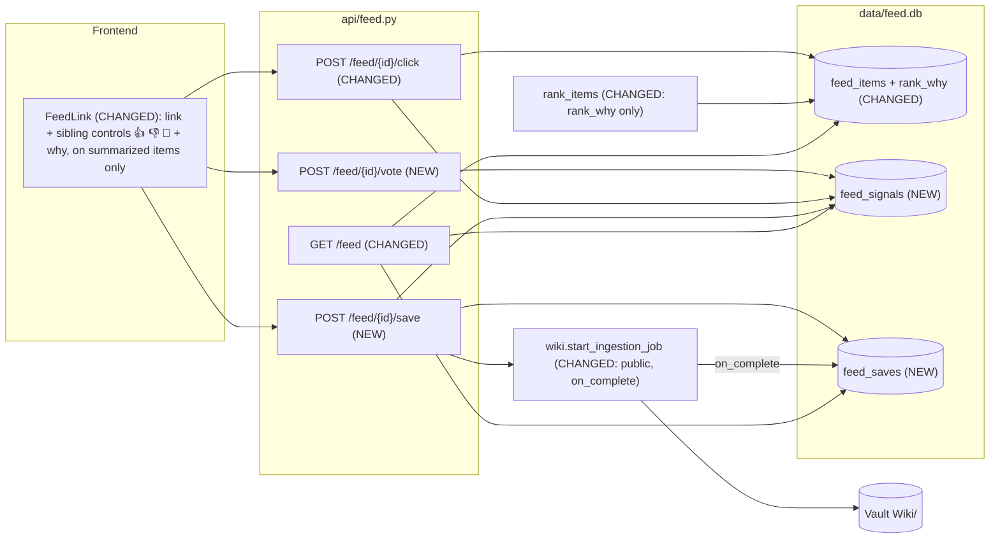

# 006 — Feed engagement learning and save to vault

ROADMAP ticket **FEED-2, slice 1 of 2**. Follow-on to FEED-1 (`docs/features/feed-attention-router.md`).

**v0.2.0 rescope (decided by Brent after review round 1, ADR-013):** FEED-2 ships in two slices.

- **Slice 1 (this spec).** Captures explicit feedback, saves to the vault, hardens click capture,
  and shows why an item ranked where it did. It does not change ranking.
- **Slice 2 (a future spec, "FEED-2 slice 2").** Adds the learning rule, the learned-weights panel and reset. It is
  drafted only if the day-28 check below shows that I actually vote. ADR-012 records where slice
  2's learned weights will live (`feed.db` deltas over the vault config, never written back to the
  note).

**v0.3.0** folds in the review round 2 findings. Brent chose controls on summarized items only, and
going straight to spec-approve with no round 3.

## Intent
I read the FEED-1 daily feed, but it has no way to hear back from me. Clicks don't help: I read the
one-line takes in place, so almost nothing gets clicked. I need three things:
- a one-tap 👍/👎 on each summarized item, recorded in a form a later learning rule can use;
- a one-tap "save to vault" that sends an item through the existing KLIB-1 pipeline and refuses to
  overwrite or pay twice;
- a "why ranked" view, so I can see what the ranker is doing today.

The goal is a feed I can correct and keep from, plus real evidence about whether I give feedback at
all, before any learning gets built on top of it.

**Evidence (measured 2026-11-22):**
- `data/feed.db` holds 968 items fetched since 2026-10-23. 183 were shown and **1 was clicked**.
- The API log has 35 `GET /api/v1/feed` requests and 2 click POSTs. One of those is a test call
  that returned 404. The log has no timestamps, so it is not a daily rate, but it shows the feed is
  opened.

## Goals
1. **Capture** 👍/👎 votes, first clicks and save requests as signal rows that outlive the 30-day
   item prune, together with the source and the matched keywords a later learning rule needs.
2. **Save** a summarized feed item to the vault with one explicit tap through KLIB-1. The item
   counts as saved only when the job succeeds, and a second save never re-runs the job while the
   page still exists.
3. **Explain** every ranked item by storing the breakdown of the score it was actually given.
4. **Harden** click capture with `navigator.sendBeacon`.
   - Nobody has seen a click get dropped. With `target=_blank` a plain `fetch` usually completes,
     so this is a cheap precaution, not a fix, and it does not feed the day-28 decision.
5. **Measure** whether feedback happens, so slice 2 is built on evidence (the day-28 check under
   Risks).

## Non-Goals
- **Changing ranking based on feedback.** The learning rule, the learned-weights panel and reset
  belong to slice 2 (a future spec, drafted only if the day-28 check passes). FEED-2's ROADMAP row notes
  this. With this spec shipped, every score is identical to FEED-1.
- **Pruning signals.** Slice 2 decides retention once it knows what the rule needs. Rows are tiny.
- **Controls on the "More from your sources" rows** of `/feed`. They stay a minimal scanning list,
  as designed in FEED-1 (Brent, round 2).
- **Writing anything into `_config/feed.md`.** ADR-012.
- **Suggesting new interest keywords.** Deferred; it would be a new FEED ticket.
- **Embeddings or any LLM call in the daily pass.** FEED-1's cost constraint holds. The only LLM
  spend is KLIB-1's, on an explicit save.
- **Hiding or filtering downvoted items.**
- **Indexing a saved page right away.** KLIB-1, as called from the API, writes to `Wiki/` without
  an index callback, so the page becomes searchable at the next reindex. This is unchanged.
- **Guarding `/wiki/ingest` against overwrites.** A URL saved there directly still re-runs and
  overwrites, which is KLIB-1's existing behaviour.
- **Changes to the digest or `_build_digest`.**
- **FEED-3 to FEED-6.**
- **Nav changes.** `/feed` is already in both `Sidebar.tsx` and `MobileNav.tsx`.

## Design



### Decisions

1. **User intent lives in `feed.db`, in tables the item prune never touches.**
   - This is a named exception to the "no application state outside the vault" principle. Votes are
     user intent and cannot be re-derived, unlike feed items.
   - It is acceptable because the data is small, local, disposable without losing anything in the
     vault, and visible on every item it applies to.
   - **This slice is where the exception starts.** ADR-012 covers only the slice-2 weights on top
     of it, so the exception itself is recorded as ADR-014.
   - Two new tables, both keyed by URL and never joined by a foreign key to `feed_items`, whose
     rows are pruned at 30 days:
     - `feed_signals` holds facts, one row per (url, channel), where channel ∈ {`thumb`, `click`,
       `save`}. A table CHECK ties each channel to its values: `thumb` ↔ `up`/`down`,
       `click` ↔ `click`, `save` ↔ `save`. Slice 2 decides how channels combine.
     - `feed_saves` holds the save lifecycle per URL. A URL that is pruned and later re-fetched
       keeps its vote and its save state.
   - `feed_items` gains only `rank_why`.

2. **The signal snapshot comes from `rank_why`, never from the vault.**
   - Every signal row copies `source_label` and the keywords from the item's stored `rank_why`
     (the config keywords it matched at rank time), spelled exactly as the config keys are,
     **case preserved**.
   - It is taken when the row is first written. A vote change rewrites the row's value and
     `created_at`, and also refreshes the snapshot from the current `rank_why`.
   - If `rank_why` is NULL (rows ranked before this ships) or its column is missing (degraded
     migration), the keywords are `[]` and the store logs the url at INFO.
   - The API never calls `load_feed_config` on a vote, click or save. That is proven by a test.

3. **Write semantics.** Each store write is **one `with self.conn:` transaction, with no `_run`
   reconnect-and-retry**, because a reconnect would roll back half of a multi-statement write. A
   write may read first (`source_label`, `rank_why`):
   - `vote up|down`:
     - Upserts the `thumb` row.
     - Re-sending the same value keeps the original `created_at`. A new value sets a new
       `created_at` and a fresh snapshot.
   - `vote none`:
     - Deletes the `thumb` row only, leaving `click` and `save` rows alone.
     - It is a no-op (200) if there is no thumb row.
     - The response is `{"vote": null}`.
   - `click`:
     - Sets `clicked_at = COALESCE(clicked_at, now)`.
     - Inserts the `click` row with `ON CONFLICT DO NOTHING`, so only the first click ever
       counts. Both happen in one transaction.
     - A DB error returns 500 and writes nothing.
     - The endpoint already declares no body, so a `sendBeacon` POST (`text/plain`) works as is;
       only the test is new.
   - `save`: the `save` row is written once a job has started (Decision 4, step 5). It stays if the
     job later fails, because the intent was expressed.

4. **Save flow.** The KLIB-1 pipeline re-fetches, re-audits, re-compiles and **overwrites** an
   existing page for the same source URL (`ingestion/pipeline.py:94-106`), so the feed guards
   against repeats itself. `POST /feed/{id}/save` (404 when `feed_enabled` is false) does these
   steps in order:
   1. `await to_thread(store.get_item)`. An unknown id returns 404 `"Feed item not found"`.
   2. `detect_content_type(url)`. A `ValueError` returns 422 with its message.
   3. `await to_thread(store.claim_save, url, now_iso, page_exists)`. This is **one conditional
      upsert statement**, so it is exclusive across connections:
      ```sql
      INSERT INTO feed_saves (url, requested_at) VALUES (?, ?)
      ON CONFLICT(url) DO UPDATE SET requested_at = excluded.requested_at,
                                     completed_at = NULL, wiki_path = NULL, error = NULL
      WHERE feed_saves.error IS NOT NULL
         OR (feed_saves.completed_at IS NULL AND feed_saves.requested_at <= ?)   -- now − 15 min
         OR (feed_saves.completed_at IS NOT NULL AND ? = 0)                       -- page gone
      ```
      - `rowcount == 1` means the claim is ours. Otherwise the endpoint returns 409:
        `"already saved to <wiki_path>"`, or `"save already in progress"`.
      - `page_exists` is checked before the statement: is `vault_path / wiki_path` still a file?
        A page I deleted in Obsidian can therefore be saved again.
      - A claim exactly 15:00 old counts as stale (`<=`).
      - The claim's `requested_at` is its **token**.
   4. `wiki.start_ingestion_job(url, on_complete=cb)` is called **on the event loop**, because it
      uses `asyncio.create_task`. If it raises (`HTTPException` for a missing vault path, or
      `RuntimeError` for a missing Anthropic key from `get_safety_auditor`), then:
      - the claim is released (`release_save(url, token)`);
      - the endpoint returns 500 with `str(exc)`, or the HTTPException's own detail;
      - no save signal is written.
   5. `await to_thread(store.record_signal, id, "save", "save")`. **If this raises, the error is
      logged and the response still succeeds.** The job is running, and `feed_saves` is the
      authoritative record.

      Then the endpoint returns `WikiIngestResponse`, and the frontend polls the existing
      `GET /wiki/ingest/{job_id}` (`wikiIngestStatus`).
   - **`on_complete` runs in a `finally` inside `_run`**, after `job.status` is final. That covers
     both the merged pipeline result and the `except` branch, which sets `FAILED` with
     `error = str(exc)`. It is called via `asyncio.to_thread`, and its own exceptions are logged,
     never raised.
   - The feed's callback does one of two things:
     - On `COMPLETE`: `complete_save(url, token, wiki_path)` stores **the path relative to the
       vault**, `Path(job.result_path).relative_to(vault_path).as_posix()` (falling back to the
       file name), and sets `error = NULL`.
     - Otherwise: `fail_save(url, token, job.error)`.
   - Both updates are `WHERE url = ? AND requested_at = token`. A late callback from a superseded
     claim changes nothing.
   - `_start_ingestion_job` is renamed `start_ingestion_job`, because two routers now depend on it.
     `wiki_ingest` passes no callback, and `feed.py` calls it as `wiki.start_ingestion_job` so
     the patch target is stable.

5. **"Why ranked" is stored at rank time and does not change the score.**
   - `rank_items` computes the same score as FEED-1 and also sets `item.rank_why`:
     `{"trust": float, "keywords": [{"keyword": str, "weight": float}], "recency": float, "score": float}`.
     Keywords are in config order, with case preserved.
   - The score always equals `trust × (1 + Σ weight) × recency` of that breakdown. That is a
     property test.
   - `add_items` writes `rank_why` in both the INSERT and the `ON CONFLICT DO UPDATE` set.
     `update_summaries` doesn't touch it, and `summarize` doesn't change `score`.
   - This JSON shape is a stored contract: slice 2 extends it, and the UI reads it. ADR-014 records
     it.

6. **Migration v1 → v2: one step at a time, degraded modes defined.**
   - `feed_signals` and `feed_saves` are created by the idempotent `_init_schema` script.
   - `_migrate` runs ordered steps. **Each step commits together with `PRAGMA user_version = N`**:
     - `version < 1`: the existing plain-text backfill, which is DML. The existing `rollback()` in
       the except stays, so a failed pass never holds the write lock.
     - `version < 2`: `ALTER TABLE feed_items ADD COLUMN rank_why TEXT`, if `PRAGMA table_info`
       lacks it. A `"duplicate column name"` `OperationalError` (the API and the cron racing)
       counts as success after re-checking `table_info`.
   - A failed step logs a warning and stops. `user_version` stays at the last completed step: from
     v0, a successful backfill and a failed ALTER leaves version **1**, so the non-idempotent
     backfill never runs twice. The next open retries the remaining steps.
   - Degraded mode (no `rank_why` column), detected once per connection with `table_info`:
     - `add_items` omits the column;
     - signals snapshot `[]`;
     - `GET /feed` returns `why: null`.

     Refresh, votes and the read path all keep working.
   - The read path parses `rank_why` defensively: bad JSON gives `why: null`. The new joins run
     inside `_fetch_recent`'s existing try, so `GET /feed` stays never-raises.

7. **Save state on read.** `get_recent` adds these fields:
   - `vote`, from the thumb row.
   - `save_state`:
     - `"saved"` when `completed_at` is set;
     - `"failed"` when `error` is set, **or** a claim is more than 15 minutes old with no
       completion (an API restart lost the job);
     - `"pending"` for a younger claim;
     - otherwise `"none"`.
   - `wiki_path`, and `save_error` (the job's error text, shown after a reload).

8. **Click capture uses `navigator.sendBeacon` (hardening).**
   - `recordFeedClick(id, nav = navigator)` calls `nav.sendBeacon(url)` **as a method**, keeping
     `this` bound to `nav`.
   - It falls back to `fetch(url, {method: "POST", keepalive: true})` when beacon is missing,
     returns `false`, or throws. Nothing propagates.

9. **Row layout and where the controls appear.**
   - `FeedLink` gains an optional `item?: FeedItem` prop. When it is present and has an `id`, the
     row is a container: the `<a>` holds title, take and meta, and 👍/👎/💾/why are **sibling**
     buttons, not nested in the anchor.
   - **Only `FeedBlock`'s summarized sections pass `item`.** That covers the Today brief and the
     top of `/feed`. `RestGroup` in `feed/page.tsx` is unchanged, so its rows get no controls.
   - Save is hidden when `safeHref` rejects the URL.
   - Re-tapping a lit 👍 or 👎 sends `"none"`, which clears it.
   - The toggle updates optimistically and **reverts** if `voteFeedItem` rejects.
   - Save shows Saving… (polling `wikiIngestStatus`), then Saved · `Wiki/x.md` with the save
     button removed, or the error with a Retry. A 409 "already saved" reply shows the Saved state.
   - The why disclosure lists trust, the matched keywords with their weights, and recency. It is
     not rendered when `why` is null.

### Interfaces (for the builder)

```python
# src/secondbrain/stores/feed.py
SignalChannel = Literal["thumb", "click", "save"]
SignalValue = Literal["up", "down", "click", "save"]

@dataclass(frozen=True)
class SaveClaim:
    ok: bool
    token: str | None            # the claim's requested_at when ok
    reason: Literal["saved", "in_progress"] | None = None
    wiki_path: str | None = None # set when reason == "saved"

def get_item(self, item_id: int) -> dict[str, Any] | None: ...
def set_vote(self, item_id: int, vote: Literal["up", "down", "none"]) -> bool:
    """False if the id is unknown. One transaction; raises sqlite3.Error on DB failure."""
def mark_clicked(self, item_id: int) -> str | None:
    """CHANGED: COALESCE clicked_at + first-click signal, one transaction. URL, or None if unknown."""
def record_signal(self, item_id: int, channel: SignalChannel, value: SignalValue) -> None
def claim_save(self, url: str, now_iso: str, page_exists: bool) -> SaveClaim:
    """One conditional upsert (Decision 4); exclusive across connections."""
def release_save(self, url: str, token: str) -> None
def complete_save(self, url: str, token: str, wiki_path: str) -> None
def fail_save(self, url: str, token: str, error: str) -> None
def get_recent(self, limit: int = 50) -> list[dict[str, Any]]:
    """CHANGED: rows also carry vote, save_state, wiki_path, save_error (Decision 7)."""
```

```python
# src/secondbrain/api/wiki.py
def start_ingestion_job(
    url: str, *, on_complete: Callable[[IngestionJob], None] | None = None
) -> str:
    """Renamed from _start_ingestion_job. Raises HTTPException(500) if vault_path unset and
    RuntimeError if the auditor can't be built. on_complete runs once, in a finally, with the
    final job; its exceptions are logged, never raised."""
```

Data:

```sql
-- in _init_schema (idempotent)
CREATE TABLE IF NOT EXISTS feed_signals (
    id INTEGER PRIMARY KEY AUTOINCREMENT,
    item_url TEXT NOT NULL,
    channel TEXT NOT NULL,
    value TEXT NOT NULL,
    source_label TEXT NOT NULL,
    keywords TEXT NOT NULL DEFAULT '[]',   -- JSON array, config keys verbatim
    created_at TEXT NOT NULL,
    UNIQUE (item_url, channel),
    CHECK ((channel = 'thumb' AND value IN ('up','down'))
        OR (channel = 'click' AND value = 'click')
        OR (channel = 'save'  AND value = 'save'))
);
CREATE TABLE IF NOT EXISTS feed_saves (
    url TEXT PRIMARY KEY,
    requested_at TEXT NOT NULL,   -- also the claim token
    completed_at TEXT,
    wiki_path TEXT,               -- vault-relative, posix
    error TEXT
);
-- _migrate step 2 (guarded by PRAGMA table_info)
ALTER TABLE feed_items ADD COLUMN rank_why TEXT;
```

API (under `/api/v1`). All new endpoints return 404 `"Feed item not found"` when `feed_enabled` is
false, matching `GET /feed`.
- `POST /feed/{id}/vote` with body `{"vote": "up"|"down"|"none"}` returns `{"vote": "up"|"down"|null}`.
  Errors: 404, 422 on any other value, 500 on a DB error.
- `POST /feed/{id}/click` returns `{"url"}` as today. Errors: 404, and 500 on a DB error.
- `POST /feed/{id}/save` returns `WikiIngestResponse`. Errors: 404, 409 (two details), 422, 500
  (as in Decision 4).
- `GET /feed`: `FeedItemResponse` gains `vote`, `save_state`, `wiki_path`, `save_error` and `why`.

Frontend:
- Add `vitest`, `jsdom` and `@testing-library/react` as devDependencies, plus an `npm test`
  script.
- Rollout needs `npm run build` and a UI service restart.

## Acceptance Criteria

```gherkin
Feature: Votes

  Scenario: Upvoting records a thumb signal with the rank-time snapshot, case preserved
    Given a ranked item from "Simon Willison" whose rank_why keywords are "agents" and "Claude"
    When I POST /api/v1/feed/{id}/vote with {"vote": "up"}
    Then the response is 200 with {"vote": "up"}
    And feed_signals has one row for its url: channel "thumb", value "up", source "Simon Willison", keywords ["agents", "Claude"]

  Scenario: Re-sending the same vote keeps its timestamp; changing it does not
    Given an item I upvoted at time T
    When I vote "up" again at T+1h
    Then the thumb row's created_at is still T
    When I vote "down" at T+2h
    Then the thumb row has value "down" and created_at T+2h

  Scenario: Clearing a vote leaves click and save signals alone
    Given an item with a click row, a save row and an "up" thumb row
    When I vote "none"
    Then the response is {"vote": null}
    And it has no thumb row, and its click and save rows are unchanged
    When I vote "none" again
    Then the response is 200 and nothing changes

  Scenario: A row ranked before this release votes with empty keywords
    Given an item whose rank_why is NULL
    When I vote "up" on it
    Then its thumb row has keywords [] and an INFO log names the url

  Scenario: Voting on an unknown item fails without writing
    When I POST /api/v1/feed/999999/vote with {"vote": "up"}
    Then the response is 404 with detail "Feed item not found" and feed_signals is unchanged

  Scenario: An invalid vote value is rejected
    When I POST /api/v1/feed/{id}/vote with {"vote": "love"}
    Then the response is 422 and feed_signals is unchanged

  Scenario: A database failure on vote is a 500, not a silent drop
    Given the real FeedStore whose connection raises sqlite3.OperationalError on the thumb upsert
    When I vote "up"
    Then the response is 500 and feed_signals is unchanged

  Scenario: The feed endpoints refuse when the feed is disabled
    Given feed_enabled is false
    When I POST vote, click or save for any id
    Then each response is 404 with detail "Feed item not found"

  Scenario: The API never reads the vault config on vote, click or save
    Given load_feed_config is patched to fail the test and vault_path is None
    When I vote "up", click, and vote "none" on an item
    Then every response is 200

  Scenario: Votes and saved state survive the item prune
    Given an upvoted item whose save completed to "Wiki/x.md", fetched 31 days ago
    When prune_old(30) runs and the same url is fetched again
    Then GET /api/v1/feed shows that url with vote "up" and save_state "saved"

Feature: Clicks

  Scenario: Only the first click is a signal, with the snapshot
    Given an item with no signals whose rank_why keywords are ["agents"] from "Latent Space"
    When I POST its click endpoint twice
    Then feed_signals has exactly one click row for its url, source "Latent Space", keywords ["agents"]
    And clicked_at equals the time of the first click

  Scenario: A click is atomic
    Given the click-signal insert raises sqlite3.OperationalError
    When I POST the click endpoint
    Then the response is 500, clicked_at is still NULL, and no click row exists

  Scenario: A beacon-shaped click is accepted
    When I POST /api/v1/feed/{id}/click with Content-Type text/plain and an empty body
    Then the response is 200 with its url and a click row exists

  Scenario: Clicking an unknown item fails without writing
    When I POST /api/v1/feed/999999/click
    Then the response is 404 with detail "Feed item not found" and feed_signals is unchanged

  Scenario: recordFeedClick prefers the beacon and falls back to keepalive fetch
    Given a navigator whose sendBeacon returns true
    When recordFeedClick(7, nav) runs
    Then sendBeacon was called once with "/api/v1/feed/7/click", with this bound to nav, and fetch was not called
    Given instead sendBeacon returns false, is undefined, or throws
    Then fetch was called with method "POST" and keepalive true, and nothing is thrown

Feature: Save to vault

  Scenario: Saving starts one KLIB-1 job and records intent with the snapshot
    Given an item from "Import AI" with rank_why keywords ["eval"], an https url and no save
    When I POST /api/v1/feed/{id}/save
    Then the response is a WikiIngestResponse with a job_id and status "fetching"
    And wiki.start_ingestion_job was called once with that url and an on_complete callback
    And feed_signals has a save row for the url with source "Import AI" and keywords ["eval"]
    And GET /api/v1/feed shows save_state "pending"

  Scenario: An item counts as saved only when the job completes, with a vault-relative path
    Given a pending save, and a job that finishes COMPLETE with result_path str(vault/"Wiki"/"x.md")
    When the real on_complete callback runs
    Then GET /api/v1/feed shows save_state "saved", wiki_path "Wiki/x.md" and save_error null

  Scenario: A failed job is reported and can be retried once
    Given a save whose job finishes FAILED with error "Content blocked by safety audit: x"
    When on_complete runs
    Then save_state is "failed", save_error is "Content blocked by safety audit: x", and the save row still exists
    When I save the item again
    Then a new job starts, save_state is "pending" and save_error is null
    When I save it a third time
    Then the response is 409 with detail "save already in progress"
    And start_ingestion_job was called exactly 2 times in total

  Scenario: A second save of a saved item never re-runs KLIB-1
    Given an item whose save completed to "Wiki/x.md" and that file exists in the vault
    When I POST its save endpoint
    Then the response is 409 with detail "already saved to Wiki/x.md"
    And no ingestion job is started

  Scenario: A page deleted from the vault can be saved again
    Given an item whose save completed to "Wiki/x.md" and that file no longer exists
    When I save it
    Then a new job starts

  Scenario: A double tap starts one job
    Given a save that is pending (requested 1 minute ago)
    When I POST its save endpoint
    Then the response is 409 with detail "save already in progress"
    And start_ingestion_job was called exactly once in total

  Scenario Outline: A stale pending claim becomes retryable at 15 minutes
    Given a pending save requested <age> ago with no completion
    When I GET /api/v1/feed
    Then its save_state is "<state>"
    When I save the item
    Then the result is <result>

    Examples:
      | age   | state   | result                 |
      | 14:59 | pending | 409 in progress        |
      | 15:00 | failed  | a new job starts       |
      | 16:00 | failed  | a new job starts       |

  Scenario: Concurrent claims are exclusive
    Given two FeedStore instances on one db and a threading.Barrier(2)
    When both call claim_save for the same url at once, repeated 50 times, for each of: a fresh url, a url whose row has an error, a url whose claim is stale
    Then in every round exactly one claim is ok and the other has reason "in_progress"

  Scenario: A late callback from a superseded claim changes nothing
    Given claim A went stale and retry B holds the claim
    When A's on_complete reports FAILED, or COMPLETE
    Then the feed_saves row still shows B's pending claim unchanged

  Scenario: Saving an unknown item fails
    When I POST /api/v1/feed/999999/save
    Then the response is 404 with detail "Feed item not found"
    And no job is started and feed_signals and feed_saves are unchanged

  Scenario: A URL the ingestion pipeline rejects is surfaced
    Given an item whose url detect_content_type rejects
    When I save it
    Then the response is 422 with the ValueError message
    And no job is started and feed_signals and feed_saves are unchanged

  Scenario Outline: A job that cannot start releases its claim
    Given <condition>
    When I save an item
    Then the response is 500 with detail "<detail>"
    And feed_saves has no row for the url and feed_signals has no save row

    Examples:
      | condition                               | detail                                                   |
      | SECONDBRAIN_VAULT_PATH is not set       | SECONDBRAIN_VAULT_PATH not configured                    |
      | SECONDBRAIN_ANTHROPIC_API_KEY is not set | Safety auditor requires SECONDBRAIN_ANTHROPIC_API_KEY    |

  Scenario: A save-signal failure after the job started still succeeds
    Given record_signal raises sqlite3.OperationalError
    When I save an item
    Then the response is the WikiIngestResponse, the error is logged, and feed_saves holds the pending claim

Feature: Ingestion job callback

  Scenario: on_complete receives the merged job
    Given IngestionPipeline.run is stubbed to return COMPLETE with result_path "/v/Wiki/x.md"
    When start_ingestion_job(url, on_complete=cb) runs and its task is awaited
    Then cb was called once with status COMPLETE and result_path "/v/Wiki/x.md"

  Scenario: on_complete runs when the pipeline raises
    Given IngestionPipeline.run raises RuntimeError("boom")
    When the task is awaited
    Then cb was called once with status FAILED and error "boom"

  Scenario: A failing callback does not break the job
    Given cb raises sqlite3.OperationalError
    When the job finishes COMPLETE
    Then GET /api/v1/wiki/ingest/{job_id} shows status "complete" and the error is logged

  Scenario: /wiki/ingest is unaffected
    When I POST /api/v1/wiki/ingest with a valid url
    Then it starts a job as before, with on_complete None

Feature: Why ranked

  Scenario: Scores are unchanged from FEED-1
    Given an item with trust 0.8, matching interest "agents" weight 2.0, published exactly 48h before now
    When rank_items runs
    Then its score is pytest.approx(1.2)

  Scenario: rank_why explains the score that was used
    Given the same item, with interests {"agents": 2.0, "Claude": 1.8} and text matching only "agents"
    When rank_items runs
    Then rank_why has trust 0.8, keywords [{"keyword": "agents", "weight": 2.0}], recency 0.5 and score approx 1.2

  Scenario: A re-ranked item gets a fresh rank_why and keeps its vote
    Given an upvoted item stored with yesterday's rank_why
    When add_items upserts it with a new rank_why
    Then the stored rank_why is the new one and the vote is still "up"

  Scenario: GET /feed returns vote, save state and why
    Given a refreshed item I upvoted
    When I GET /api/v1/feed
    Then that item has vote "up", save_state "none", wiki_path null, save_error null, and why with keys trust, keywords, recency, score

  Scenario: Malformed or missing rank_why never breaks the feed
    Given one row with rank_why "{not json" and one with rank_why NULL
    When I GET /api/v1/feed
    Then the response is 200 and both items have why null

Feature: Store migration

  Scenario: A v1 db upgrades without re-running the backfill
    Given a feed.db at user_version 1 with a row whose title is "A &amp; B"
    When FeedStore opens it
    Then user_version is 2, rank_why exists, feed_signals and feed_saves exist
    And the title is still "A &amp; B"

  Scenario: A v0 db runs both steps
    Given a feed.db at user_version 0 with a row whose title contains "&amp;"
    When FeedStore opens it
    Then the title is unescaped and user_version is 2

  Scenario: A fresh db is current
    When FeedStore creates a new db
    Then user_version is 2

  Scenario: A column added by another process counts as migrated
    Given a db at user_version 1 that already has a rank_why column
    When FeedStore opens it
    Then no exception is raised and user_version is 2

  Scenario: The migration race counts as migrated
    Given table_info reports no rank_why but the ALTER raises OperationalError "duplicate column name: rank_why" because the column now exists
    When FeedStore opens the db
    Then no exception is raised and user_version is 2

  Scenario Outline: A failed step degrades, keeps completed steps, and retries
    Given a db at user_version <from> and the v2 ALTER raises sqlite3.OperationalError
    When FeedStore opens it
    Then no exception is raised, user_version is <after>, and a warning is logged
    And add_items still stores items without rank_why
    And voting on an item returns 200 with a thumb row whose keywords are []
    And GET /api/v1/feed returns 200 with why null
    When the db is opened again without the fault
    Then user_version is 2

    Examples:
      | from | after |
      | 1    | 1     |
      | 0    | 1     |

Feature: Feed row controls (vitest)

  Scenario: Clicking the link still records a click
    Given a FeedLink with an item of id 7 and a safe url
    When I click the anchor
    Then recordFeedClick(7) was called

  Scenario: Tapping a control neither opens the link nor records a click
    Given the same FeedLink
    When I click its 👍 button
    Then voteFeedItem(7, "up") was called (vi.mock spy)
    And the button has no ancestor <a>, and recordFeedClick was not called

  Scenario: Re-tapping a lit vote clears it, and a failed vote reverts
    Given an item with vote "up"
    When I click 👍
    Then voteFeedItem(7, "none") was called
    Given instead voteFeedItem rejects
    Then the toggle returns to its previous state

  Scenario: Controls appear only on summarized items with an id and a safe url
    Given a FeedLink without an item prop (a RestGroup row)
    Then no controls render
    Given an item with id undefined
    Then no controls render
    Given an item with id 7 and a "javascript:" url
    Then no save control renders

  Scenario: The why disclosure shows the breakdown, or nothing
    Given an item whose why has trust 0.8, keyword "agents" 2.0, recency 0.5
    When I open the why disclosure
    Then it lists 0.8, "agents" with 2.0, and 0.5
    Given an item whose why is null
    Then no why control renders

  Scenario: Save states render
    Given an item with save_state "saved" and wiki_path "Wiki/x.md"
    Then "Wiki/x.md" is shown and there is no save button
    Given an item with save_state "failed" and save_error "blocked"
    Then "blocked" and a Retry button are shown
    Given saveFeedItem rejects with 409 "already saved to Wiki/x.md"
    Then the Saved state with "Wiki/x.md" is shown
```

## Properties

- **The why explains the score.** For any item (trust 0–1, any title or snippet, any published
  date or none) and any interests map (keys of any case, weights 0–10), `item.score` ≈
  `why.trust × (1 + Σ why.keywords[].weight) × why.recency` (`math.isclose`, rel 1e-9), and every
  `why.keywords[].keyword` is a key of the interests map, verbatim. Hypothesis.
  `tests/unit/feed/test_rank.py::test_rank_why_reproduces_score`.
- **No change in ordering from FEED-1.** For item lists with unique urls, the url sequence from
  `rank_items` equals the sequence from the pre-change formula, re-implemented in the test as an
  independent oracle. `test_rank.py::test_order_matches_feed1_oracle`.
- **One signal per channel.** Any sequence of vote (up/down/none), click and save operations on
  one item leaves at most one row per (url, channel). The thumb row's value equals the last
  non-`none` vote, or is absent if the last vote was `none`. The click row exists iff any click
  happened. Hypothesis `RuleBasedStateMachine` with an in-memory dict as the oracle. A
  planted-bug control (`set_vote` that inserts instead of upserting) is a deterministic witness
  that must fail. `tests/unit/feed/test_store_feed.py::SignalMachine`.

## Risks & Open Questions

- **Will I actually vote? That is the whole bet of slice 1.** Of 183 items shown, 1 was clicked,
  while the log shows 35 feed loads. So the feed is read in place, and clicks were the wrong
  measure.
  - **Day-28 check, 28 days after rollout:**
    `sqlite3 data/feed.db "SELECT value, COUNT(*) FROM feed_signals GROUP BY value"`.
  - **≥ 15 `up` + `down` rows:** draft the slice-2 spec (the learning rule). ADR-012 covers its storage,
    and `docs/specs/reviews/006-*.r1.md` holds its design feedback.
  - **Fewer:** close FEED-2 at slice 1 and look at relevance or surfacing instead: source mix,
    top-N size, whether the brief shows enough. Record either outcome as an ADR.
  - The count is of *current* rows: a vote cleared with `none` leaves no trace. I accept that
    knowingly. A vote I took back is not engagement worth learning from.
- **Save state is partly in the API process.** If the API restarts mid-job, the claim reads as
  `failed` after 15 minutes and can be retried. There is no silent duplicate.
- **Page-exists check.** `claim_save` treats a missing `vault_path / wiki_path` as "not saved". A
  page I *moved* in Obsidian therefore looks deleted, and saving again re-runs KLIB-1. It writes to
  the original `Wiki/` path, not over the moved copy, so this is acceptable.
- **Two processes write to `feed.db`.** The API writes signals and saves, and the cron writes
  items. This is FEED-1's existing WAL plus busy_timeout=5000 pattern. Migration races are covered
  in Decision 6, and claim exclusivity by a single statement plus a concurrency test.
- **New dev-only test tooling.**
  - Frontend: vitest, jsdom and RTL, the frontend's first test dependencies (Brent, round 1).
  - Backend: Hypothesis.
- **Spec 005 is still listed as Draft in the Witt index.** ROADMAP says it was Abandoned (ADR-011),
  but `spec_index` still shows it as Draft, and its file is untracked in the working tree. Its
  `tooling` lane would have changed the same rank formula. This spec assumes 005 does not ship.

## Files

| File | Action | Note |
|---|---|---|
| `src/secondbrain/feed/rank.py` | Update | compute and attach `rank_why` (config keys verbatim); score unchanged |
| `src/secondbrain/feed/models.py` | Update | `FeedItem.rank_why` |
| `src/secondbrain/stores/feed.py` | Update | per-step migration v2; `feed_signals` (channel↔value CHECK) + `feed_saves`; `rank_why` in insert **and** upsert set (omitted in degraded mode); `SaveClaim` + new methods; `mark_clicked` one transaction; `get_recent` joins + `save_state` |
| `src/secondbrain/api/feed.py` | Update | vote, save (ordered flow, claim token, callback), click 500 on DB error, `feed_enabled` 404s, `GET /feed` new fields |
| `src/secondbrain/api/wiki.py` | Update | rename to `start_ingestion_job(..., on_complete=None)`; callback in `finally`; `wiki_ingest` call site |
| `src/secondbrain/models.py` | Update | `FeedItemResponse` fields; `FeedVoteRequest` |
| `pyproject.toml` | Update | `hypothesis` in the dev dependency group |
| `frontend/package.json` | Update | `vitest`, `jsdom`, `@testing-library/react` devDependencies; `test` script |
| `frontend/vitest.config.ts` | New | jsdom environment, `@/` alias |
| `frontend/src/components/feed/FeedBlock.tsx` | Update | `FeedLink` optional `item` prop → container with sibling controls, why disclosure, save states; only summarized sections pass `item` |
| `frontend/src/lib/api.ts` | Update | `voteFeedItem`, `saveFeedItem`; reuse `wikiIngestStatus`; `recordFeedClick(id, nav)` via sendBeacon |
| `frontend/src/lib/types.ts` | Update | `FeedItem.vote/save_state/wiki_path/save_error/why` |
| `frontend/src/lib/api.test.ts` | New | recordFeedClick branches incl. `this` binding and throw |
| `frontend/src/components/feed/FeedBlock.test.tsx` | New | the "Feed row controls" scenarios |
| `docs/ROADMAP.md` | Update | FEED-2 row: slice 1 = spec 006; slice 2 (learning) = a future spec after the day-28 check |
| `tests/unit/feed/test_rank.py` | Update | FEED-1 golden score, rank_why shape + case, both rank Properties |
| `tests/unit/feed/test_store_feed.py` | Update | signal semantics + atomicity, `SignalMachine`, claim concurrency/retry/stale/late-callback, migration (v0, v1, fresh, existing column, race, failure from v0/v1 + retry), upsert refreshes rank_why; `test_marks_the_database_migrated` and `test_fresh_database_is_marked_current` assert `== 2` |
| `tests/test_feed_api.py` | Update | vote/click/save/GET scenarios; patch `secondbrain.api.wiki.start_ingestion_job`; settings cases set the cached settings |
| `tests/test_wiki_api.py` | Update | callback scenarios; `/wiki/ingest` unchanged |

## Implementation Plan

> **Status:** Approved — ready to execute
> **Executor notes:**
> - Backend phases (1–5) are strictly ordered: schema → rank → store → wiki → API.
> - The frontend (6) needs only the API contract, so it can start after phase 5's response
>   models land.
> - Always run Python through `uv run python -m pytest` (Anaconda shadows pytest).
> - Tests use `tmp_path` only, never the live `data/feed.db` or the vault.
> - Stage files by name; other sessions share this working tree.
> - Full suite baseline: 1162 tests.

### Phase 0 — Tooling
- [ ] 0.1 Add `hypothesis` to the `[dependency-groups] dev` group (`uv add --dev hypothesis`) — files: `pyproject.toml`, `uv.lock` — done when: `uv run python -c "import hypothesis"` exits 0.
- [ ] 0.2 Add `vitest`, `jsdom` and `@testing-library/react` as devDependencies, a `"test": "vitest run"` script, and `vitest.config.ts` (jsdom env, `@/` alias) — files: `frontend/package.json`, `frontend/package-lock.json`, `frontend/vitest.config.ts` — done when: `npm test` in `frontend/` runs a throwaway smoke test green, and the smoke test is deleted afterwards.

### Phase 1 — Schema and migration (`stores/feed.py`)
- [ ] 1.1 Tests first: the "Store migration" scenarios (v1 keeps `&amp;`, v0 both steps, fresh db at 2, existing column, duplicate-column race, failure outline from v0 and v1 + retry), and change `test_marks_the_database_migrated` / `test_fresh_database_is_marked_current` to `== 2` — files: `tests/unit/feed/test_store_feed.py` — done when: the new tests fail for the expected reason.
- [ ] 1.2 Add `feed_signals` (with the channel↔value CHECK) and `feed_saves` to `_init_schema`. Make `_migrate` per-step, each step committing with its own `user_version`. Keep the v1 rollback. Add the v2 ALTER with the `table_info` guard and the duplicate-column handling, plus degraded-mode detection (`_has_rank_why`) — files: `src/secondbrain/stores/feed.py` — done when: the 1.1 tests pass and `tests/unit/feed/test_store_feed.py` is fully green.

### Phase 2 — rank_why (`feed/rank.py`, `feed/models.py`, `stores/feed.py`)
- [ ] 2.1 Tests first: the "Scores are unchanged from FEED-1" golden test, "rank_why explains the score" (mixed-case `"Claude"`), the Properties `test_rank_why_reproduces_score` and `test_order_matches_feed1_oracle` — files: `tests/unit/feed/test_rank.py` — done when: they fail only because `rank_why` is missing.
- [ ] 2.2 `FeedItem.rank_why`; `_score_with` also returns the breakdown (config keys verbatim, config order); `rank_items` attaches it with the score unchanged — files: `src/secondbrain/feed/models.py`, `src/secondbrain/feed/rank.py` — done when: the 2.1 tests and the existing `test_rank.py` pass.
- [ ] 2.3 Tests first, then implementation: `add_items` writes `rank_why` JSON in the INSERT and the `ON CONFLICT` set, omitting it in degraded mode (scenario "A re-ranked item gets a fresh rank_why") — files: `src/secondbrain/stores/feed.py`, `tests/unit/feed/test_store_feed.py` — done when: that scenario and `tests/unit/feed/test_pipeline.py` are green.

### Phase 3 — Signals (`stores/feed.py`)
- [ ] 3.1 Tests first: the store halves of the vote scenarios (snapshot + case, re-send keeps `created_at`, a change refreshes it and the snapshot, `none` keeps click and save rows, NULL rank_why → `[]` + INFO, atomic failure with a real connection fault), the click scenarios (first click only + snapshot, atomic failure), and `SignalMachine` with its planted-bug control — files: `tests/unit/feed/test_store_feed.py` — done when: they fail on the missing methods.
- [ ] 3.2 Implement `get_item`, `set_vote`, `record_signal` and the changed `mark_clicked`, each as one `with self.conn:` transaction without `_run` retry, with the snapshot taken from `rank_why` — files: `src/secondbrain/stores/feed.py` — done when: the 3.1 tests pass, including the planted-bug control failing as designed.

### Phase 4 — Save claims (`stores/feed.py`)
- [ ] 4.1 Tests first: claim on a fresh url, claim over an error row (resets error/completed_at), the 14:59/15:00/16:00 stale outline, saved + page exists → `"saved"`, page gone → claimable, release/complete/fail keyed on the token, a late superseded callback changes nothing, `test_claim_save_is_exclusive_under_concurrency` (two stores, `Barrier(2)`, 50 rounds × 3 cases), and `get_recent`'s `save_state` mapping, including stale → `"failed"` — files: `tests/unit/feed/test_store_feed.py` — done when: they fail on the missing methods.
- [ ] 4.2 Implement `SaveClaim`, `claim_save` (the single conditional upsert from Decision 4), `release_save`, `complete_save` (sets `error = NULL`) and `fail_save`, plus the `get_recent` joins (vote, save_state, wiki_path, save_error) — files: `src/secondbrain/stores/feed.py` — done when: the 4.1 tests pass, and the concurrency test passes 3 runs in a row.

### Phase 5 — Ingestion callback and API
- [ ] 5.1 Tests first: the "Ingestion job callback" scenarios (merged COMPLETE, a raise → FAILED "boom", a failing callback is logged and the job is still complete, `/wiki/ingest` unchanged) — files: `tests/test_wiki_api.py` — done when: they fail.
- [ ] 5.2 Rename `_start_ingestion_job` → `start_ingestion_job(url, *, on_complete=None)`, with the callback in a `finally` via `asyncio.to_thread` and its exceptions logged. Update the `wiki_ingest` call site — files: `src/secondbrain/api/wiki.py` — done when: the 5.1 tests and all of `tests/test_wiki_api.py` pass.
- [ ] 5.3 Response models: `FeedItemResponse` gains `vote`, `save_state`, `wiki_path`, `save_error`, `why`; add `FeedVoteRequest`. `_to_item` parses `rank_why` defensively — files: `src/secondbrain/models.py`, `src/secondbrain/api/feed.py` — done when: the "GET /feed returns vote, save state and why" and "Malformed or missing rank_why" API tests pass, alongside the existing `tests/test_feed_api.py`.
- [ ] 5.4 Tests first, then implementation: `POST /feed/{id}/vote` and the changed click endpoint. Covers 404/422/500, `feed_enabled` 404s, the beacon-shaped click, the click DB-error 500, and `test_vote_click_save_never_load_feed_config` — files: `src/secondbrain/api/feed.py`, `tests/test_feed_api.py` — done when: those scenarios pass.
- [ ] 5.5 Tests first, then implementation: `POST /feed/{id}/save` with the ordered flow (get_item → detect → page_exists → claim → `wiki.start_ingestion_job` on the loop → signal, which is logged if it fails), and the feed callback storing the vault-relative path. Covers every "Save to vault" API scenario, including the 500 outline (vault path, Anthropic key) and the 2-jobs retry. Patch `secondbrain.api.wiki.start_ingestion_job` — files: `src/secondbrain/api/feed.py`, `tests/test_feed_api.py` — done when: all "Save to vault" scenarios pass.

### Phase 6 — Frontend
- [ ] 6.1 Types and API client: `FeedItem` fields; `voteFeedItem`, `saveFeedItem`; `recordFeedClick(id, nav)` via sendBeacon as a method, with the keepalive-fetch fallback on missing/false/throw. Test it in `api.test.ts` (the branches, `this` binding, a throw) — files: `frontend/src/lib/types.ts`, `frontend/src/lib/api.ts`, `frontend/src/lib/api.test.ts` — done when: `npm test` is green for `api.test.ts`.
- [ ] 6.2 `FeedLink` gets the optional `item` prop. The row becomes a container: anchor plus sibling 👍/👎/💾/why, optimistic toggle with revert, re-tap → `none`, save states including handling the 409, and the why disclosure. Only `FeedBlock`'s summarized sections pass `item`; `feed/page.tsx` stays unchanged. Write `FeedBlock.test.tsx` covering every "Feed row controls" scenario — files: `frontend/src/components/feed/FeedBlock.tsx`, `frontend/src/components/feed/FeedBlock.test.tsx` — done when: `npm test` is green, and `npm run build` and `npm run lint` succeed.

### Phase 7 — Docs
- [ ] 7.1 FEED-2 ROADMAP row: slice 1 = spec 006, slice 2 = a future spec after the day-28 check (ADR-013) — files: `docs/ROADMAP.md` — done when: the row is updated and `git diff --stat` shows only that file for this step.

### Verification
- [ ] ruff clean: `uv run ruff check src tests` and `uv run ruff format --check src tests`.
- [ ] mypy clean on the touched modules (`make typecheck`).
- [ ] The full pytest suite is green: `uv run python -m pytest -q` (paste the summary line; expect ≥ 1162 + new).
- [ ] Frontend: `npm test`, `npm run lint` and `npm run build` are green in `frontend/`.
- [ ] Import smoke test: `uv run python -c "from secondbrain.stores.feed import FeedStore, SaveClaim; from secondbrain.api.wiki import start_ingestion_job"`.
- [ ] Live migration check: back up the live db (`cp data/feed.db data/feed.db.bak-006`), then open it with `uv run python -c "from pathlib import Path; from secondbrain.stores.feed import FeedStore; s=FeedStore(Path('data/feed.db')); s.get_recent(1); print(s.conn.execute('PRAGMA user_version').fetchone()[0])"`. It prints `2`.

### Rollout
- [ ] R.1 Restart the API (launchd unload/kill/load per MEMORY.md); `curl -s http://localhost:8000/health` returns ok.
- [ ] R.2 Rebuild and restart the UI (`npm run build`, then launchd unload/kill/load); `curl` on `:7860` returns 200.
- [ ] R.3 Manual QA on the phone over Tailscale: vote on one item, then reload and check the vote is still lit; save one item, see Saved · `Wiki/…`, and check the page exists in the vault; a second tap shows Saved with no new job (`GET /wiki/ingest` not called again).
- [ ] R.4 Put the day-28 check on the calendar (rollout date + 28 days) with the SQL from Risks.

### Key decisions
| Decision | Rationale |
|---|---|
| Feedback in `feed.db` tables outside the item prune (ADR-014) | User intent can't be re-derived. It's small, local and visible, and the vault keeps the saved page |
| Two slices; learning waits for ≥ 15 thumbs (ADR-013) | 1 click in 183 impressions: prove the voting habit before building learning on it |
| Snapshot keywords from `rank_why`, never from the vault config | No vault read on hot endpoints and no silent seed-default fallback; it records what actually ranked the item |
| Save claim = one conditional upsert, keyed by a `requested_at` token | Exclusive across connections without locks; late callbacks from superseded jobs are inert |
| Saved only when the job succeeds, via an `on_complete` in a `finally` | A failed audit or fetch must not show "saved"; the `finally` also covers the raise path |
| A missing vault page makes the item re-saveable | The vault is the source of truth; deleting the page in Obsidian is honoured |
| Per-step migration version bumps | The v1 HTML backfill isn't idempotent, so it must never run twice |
| Controls on summarized items only | That's what gets read; the rest rows stay a minimal scanning list (FEED-1 design, Brent r2) |
| vitest + jsdom + RTL; Hypothesis | Branching UI logic and sequence properties need real tests (Brent r1) |
